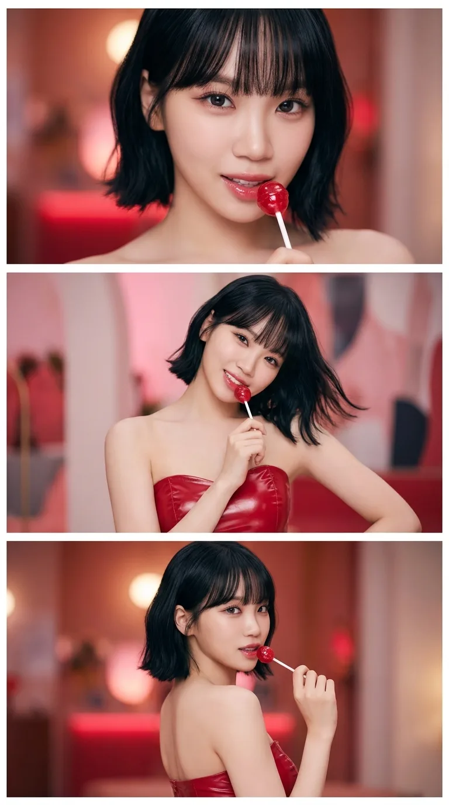

# Portrait, Cinematic

[← Back to the collection](../../README.md) · Category: [Photography](../../gallery/photography.md) · Model: `Vinano Image Pro` · ID: `vn-01691`

<a href="https://vinano.ai?utm_source=github&utm_medium=readme&utm_campaign=awesome-image-video-prompts-updating&utm_content=prompt-page-image"></a>

<sub>Preview generated with <a href="https://vinano.ai?utm_source=github&utm_medium=readme&utm_campaign=awesome-image-video-prompts-updating&utm_content=prompt-page-caption">vinano.ai</a></sub>

## Prompt

```text
Create a 3-image vertical collage (aspect ratio 9:16) featuring Le Sserafim's Kim Chaewon, showcasing her distinct features and short black bob bangs, wearing a vibrant cherry-red strapless latex dress a glossy finish. She is posing a red lollipop.
Image 1: Close-up portrait — Kim Chaewon looks directly at the camera a soft, teasing smile, her glossy lips slightly parted, holding the red lollipop near her mouth. The shot highlights her precise features and dark hair. Warm lighting, smooth skin tones, shallow depth of field, cinematic glow.
Image 2: Mid-shot — Kim Chaewon tilts her head slightly, the lollipop resting gently against her lips, a playful expression in her dark eyes. Her short hair is softly flowing, showing subtle highlights. She wears the red strapless latex dress. Modern aesthetic background soft pink and red tones.
Image 3: Side profile pose — Kim Chaewon looks over her shoulder while holding the lollipop near her chin, her distinctive profile on display a confident and flirty expression. The texture of the red latex dress is visible. Soft studio lighting, blurred background, high-fashion editorial style.
Overall Style: High-resolution, glossy magazine editorial look, soft glam makeup, cherry-red color theme, smooth skin retouching, aesthetic Instagram collage layout, clean white borders between images.

Emphasise material texture and natural light so the final frame feels tactile and premium.
```

## Try it on vinano.ai

1. Copy the prompt above.
2. Open **[vinano.ai](https://vinano.ai?utm_source=github&utm_medium=readme&utm_campaign=awesome-image-video-prompts-updating&utm_content=prompt-page-try)**, paste it into the image generator and pick a model.
3. Swap any placeholders (brand, product, city, person…) for your own details, then generate.

More prompts like this: [Photography gallery](../../gallery/photography.md) · [all categories](../../README.md#contents)
