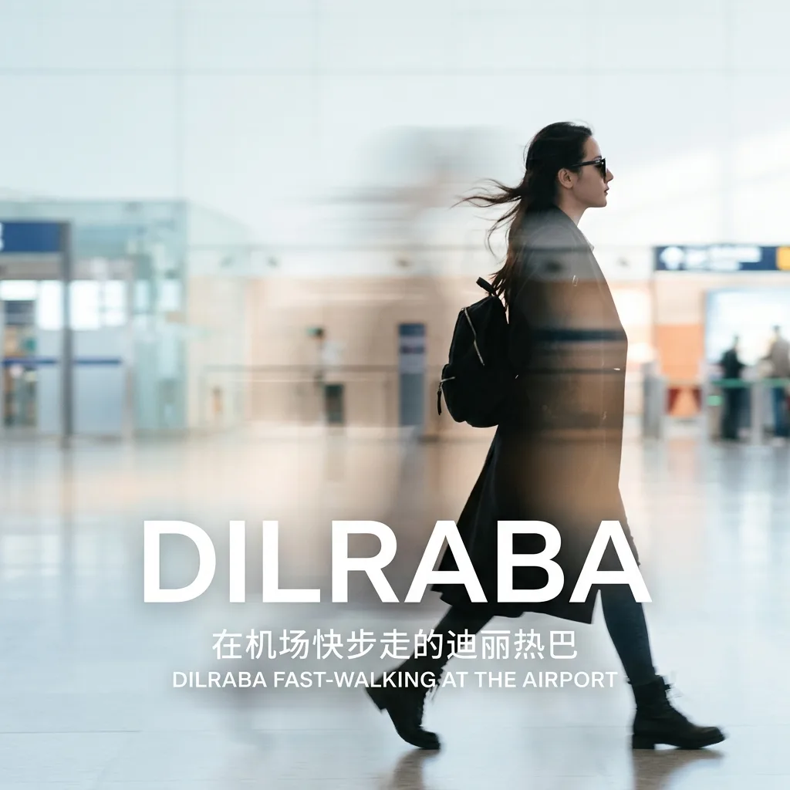

# 围绕具体主题内容生成一张具有电影感的

[← Back to the collection](../../README.md) · Category: [Photography](../../gallery/photography.md) · Model: `Vinano Image v2` · ID: `vn-01720`

<a href="https://vinano.ai?utm_source=github&utm_medium=readme&utm_campaign=awesome-image-video-prompts-updating&utm_content=prompt-page-image"></a>

<sub>Preview generated with <a href="https://vinano.ai?utm_source=github&utm_medium=readme&utm_campaign=awesome-image-video-prompts-updating&utm_content=prompt-page-caption">vinano.ai</a></sub>

## Prompt

```text
围绕具体主题内容生成一张具有电影感的动态拖影肖像画面：主体以安静的侧面轮廓或半身剪影占据主要视觉重量，面部边缘保持少量可辨识细节，身体和头发向一侧被拉成长距离水平运动模糊，拖影像光带一样穿过主体并逐渐融入背景，使人物像正在被速度、记忆或信息流带走。背景是一整片高明度、清透、柔和的空气场，不做复杂场景，色彩从主题自身的材质、情绪和叙事温度中提取，保留大面积明亮冷静底色、较深主体暗部、少量高饱和发光强调色与干净色阶之间的关系，形成梦幻而清洁的冷暖张力，避免浑浊、陈旧和烟灰感。光线柔软扩散，焦点略松，边缘有轻微胶片颗粒和镜头晕散，但整体仍然通风、透明、现代。画面信息密度很低，留出大量空域让速度感呼吸；文字作为视觉结构的一部分使用纯白现代无衬线字体，核心词用极大字号放在主体下方或画面重心附近，短句说明使用较小字号、紧凑行距和居中节奏，所有文字像叠在光雾上的清晰界面层，既压住画面层级，又不破坏柔焦影像的流动感。

本次主题：[在机场快步走的迪丽热巴]

比例3:4

追求杂志编辑式的设计感，刻意安排留白与视觉重心。
```

## Try it on vinano.ai

1. Copy the prompt above.
2. Open **[vinano.ai](https://vinano.ai?utm_source=github&utm_medium=readme&utm_campaign=awesome-image-video-prompts-updating&utm_content=prompt-page-try)**, paste it into the image generator and pick a model.
3. Swap any placeholders (brand, product, city, person…) for your own details, then generate.

More prompts like this: [Photography gallery](../../gallery/photography.md) · [all categories](../../README.md#contents)
