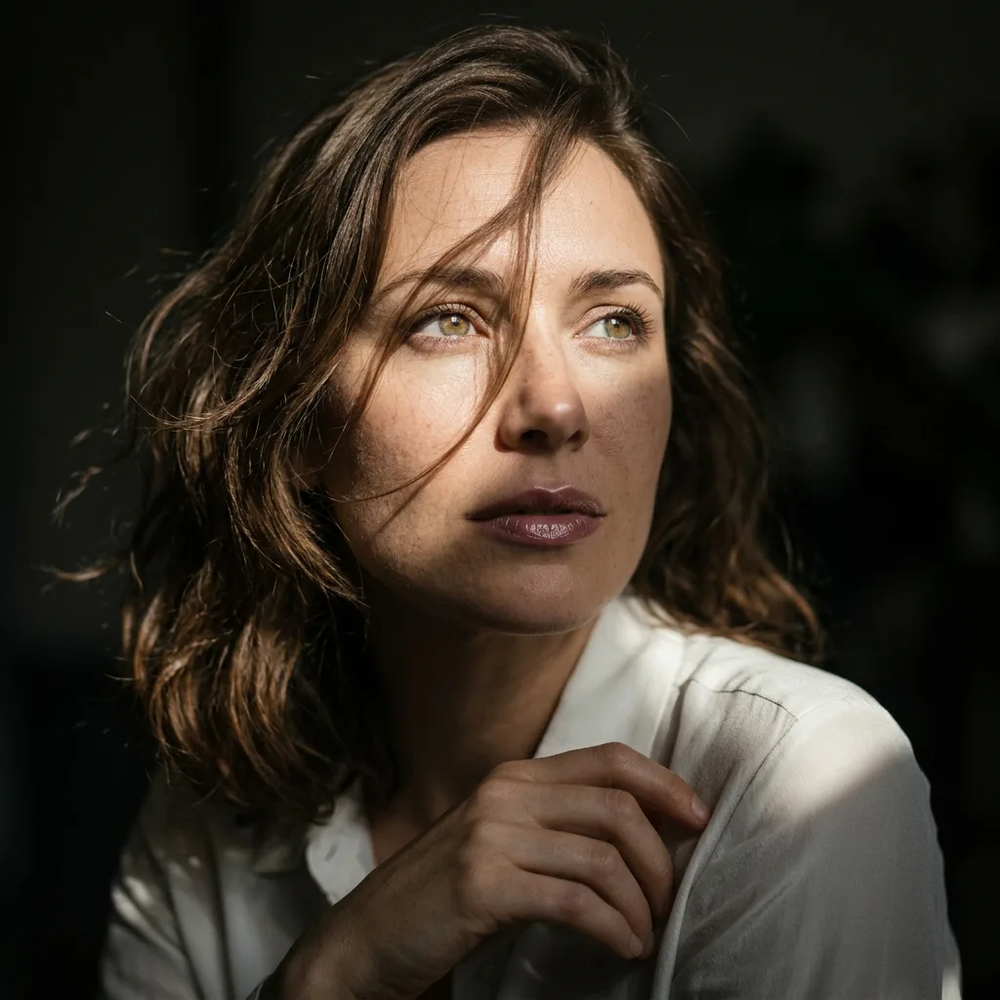

# Realistic, Portrait

[← Back to the collection](../../README.md) · Category: [Photography](../../gallery/photography.md) · Model: `Vinano Image v2` · ID: `vn-01750`

<a href="https://vinano.ai?utm_source=github&utm_medium=readme&utm_campaign=awesome-image-video-prompts-updating&utm_content=prompt-page-image"></a>

<sub>Preview generated with <a href="https://vinano.ai?utm_source=github&utm_medium=readme&utm_campaign=awesome-image-video-prompts-updating&utm_content=prompt-page-caption">vinano.ai</a></sub>

## Prompt

```text
Hyper-realistic cinematic Create an 8k close-up portrait of a beautiful woman medium, brown, slightly wind-swept hair falling across her face. Her striking, light-colored eyes gaze upwards and to the right, catching a sharp, diagonal beam of natural light that illuminates the high points of her cheekbone, nose, and plump, fair skin, glossy, mauve-toned lips a slightly light weight silk shirt. The rest of her face and the background are cast in deep,dramatic shadow (chiaroscuro) emphasizing the play of light and shadow Subtle textures of her dark clothing are visible on her left shoulder. The image should capture a mysterious and introspective mood, incredible detail in her skin, hair strands, and the subtle reflections in her eyes and lips.
Outfit should white.

Maintain consistent colour harmony and crisp focus across the whole frame.
```

## Try it on vinano.ai

1. Copy the prompt above.
2. Open **[vinano.ai](https://vinano.ai?utm_source=github&utm_medium=readme&utm_campaign=awesome-image-video-prompts-updating&utm_content=prompt-page-try)**, paste it into the image generator and pick a model.
3. Swap any placeholders (brand, product, city, person…) for your own details, then generate.

More prompts like this: [Photography gallery](../../gallery/photography.md) · [all categories](../../README.md#contents)
