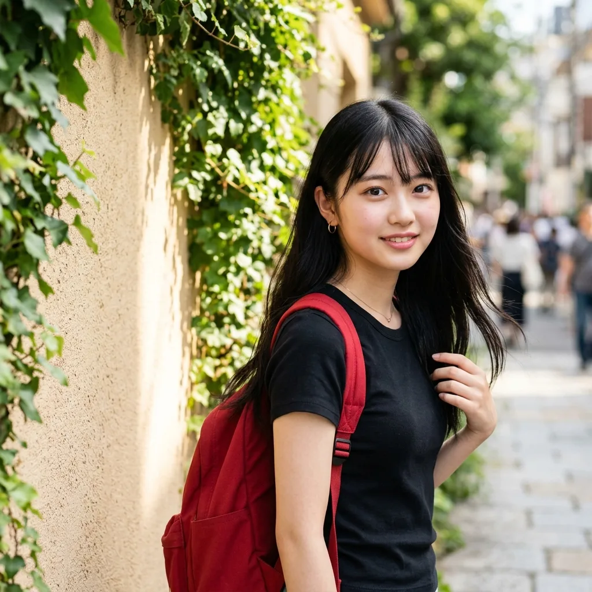

# Realistic, Portrait

[← Back to the collection](../../README.md) · Category: [Photography](../../gallery/photography.md) · Model: `Vinano Image v2` · ID: `vn-01754`

<a href="https://vinano.ai?utm_source=github&utm_medium=readme&utm_campaign=awesome-image-video-prompts-updating&utm_content=prompt-page-image"></a>

<sub>Preview generated with <a href="https://vinano.ai?utm_source=github&utm_medium=readme&utm_campaign=awesome-image-video-prompts-updating&utm_content=prompt-page-caption">vinano.ai</a></sub>

## Prompt

```text
Beautiful young Japanese girl long silky black hair and soft wispy bangs, large expressive dark eyes, fair glowing skin, delicate facial features, natural pink lips, subtle blush, and a calm innocent expression. Wearing a fitted black t-shirt and a red backpack over one shoulder. Standing outdoors beside a warm beige wall green leaves casting soft shadows. Bright midday sunlight creating natural highlights on her hair and face, gentle breeze moving loose strands of hair, casual school-day aesthetic, Korean/Japanese street photography vibe, realistic skin texture, soft natural makeup, candid portrait, true-to-life photorealistic, ultra-detailed, DSLR quality, shallow depth of field, crisp composition, vibrant natural colors, youthful and dreamy atmosphere, 85mm lens, high-resolution editorial portrait, 8K. Aim for an editorial, design-driven look with deliberate negative space.
```

## Try it on vinano.ai

1. Copy the prompt above.
2. Open **[vinano.ai](https://vinano.ai?utm_source=github&utm_medium=readme&utm_campaign=awesome-image-video-prompts-updating&utm_content=prompt-page-try)**, paste it into the image generator and pick a model.
3. Swap any placeholders (brand, product, city, person…) for your own details, then generate.

More prompts like this: [Photography gallery](../../gallery/photography.md) · [all categories](../../README.md#contents)
