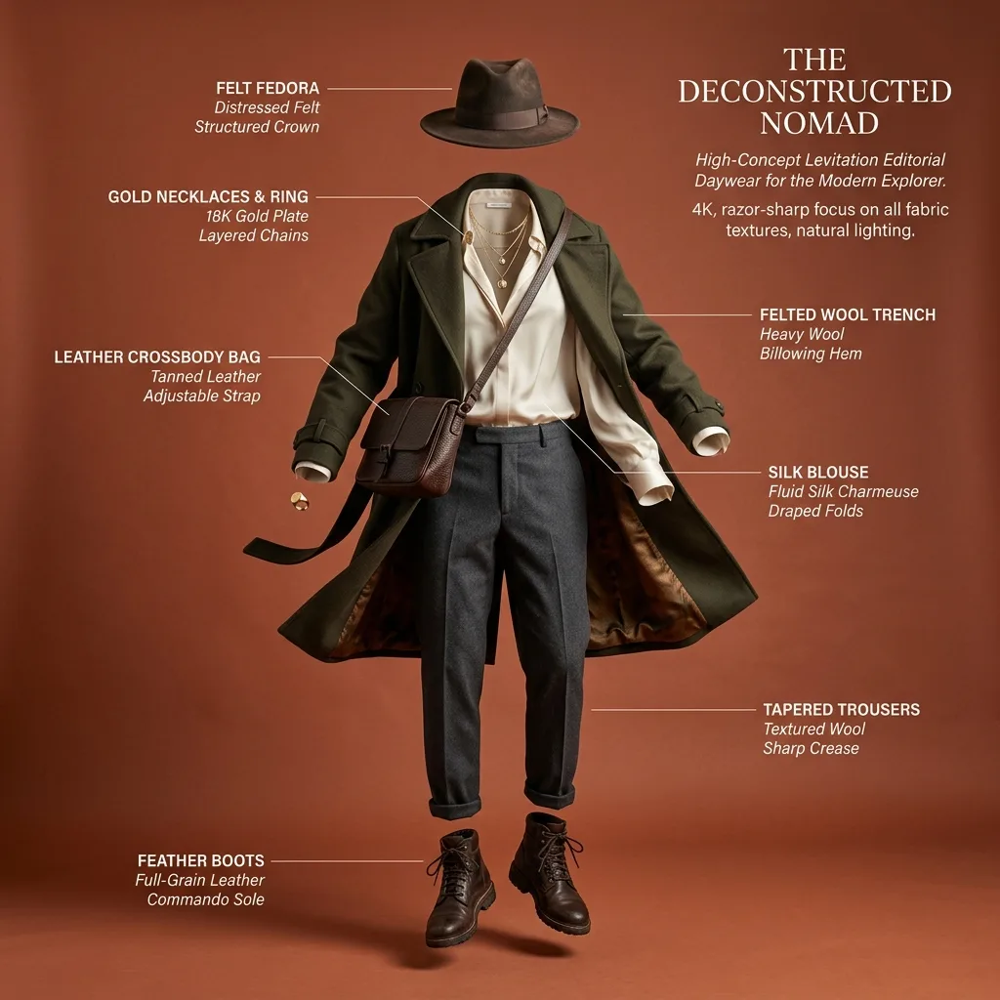

# Complete STYLE outfit floating in its exact worn position

[← Back to the collection](../../README.md) · Category: [Photography](../../gallery/photography.md) · Model: `Vinano Image Pro` · ID: `vn-01784`

<a href="https://vinano.ai?utm_source=github&utm_medium=readme&utm_campaign=awesome-image-video-prompts-updating&utm_content=prompt-page-image"></a>

<sub>Preview generated with <a href="https://vinano.ai?utm_source=github&utm_medium=readme&utm_campaign=awesome-image-video-prompts-updating&utm_content=prompt-page-caption">vinano.ai</a></sub>

## Prompt

```text
Complete [STYLE] outfit floating in its exact worn position around an invisible body every piece suspended mid-breath, mid-billow. LOOK (bottom to top): [FOOTWEAR] → [BOTTOMS] → [TOP] → [LAYER] → [ACCESSORIES] → [JEWELLERY] → [HEADWEAR] FABRIC PHYSICS: each material true to its weight, wool hangs, silk drapes, denim holds its crease, leather keeps its shape. Every edge lifting slightly as if caught in one silent gust. LABELS: hairline leader to floating label box. "[GARMENT]" uppercase / "[FABRIC]" italic / "[ONE DEFINING DETAIL]" LIGHTING: soft directional from upper left + warm fill from below catching linings and sole edges + cool rim outlining the silhouette. BACKGROUND: [COLOR] seamless, fashion-forward. TITLE: "[LOOK NAME]" elegant serif type, top right. SUBTITLE: "[MOOD / OCCASION]" italic. Mood: high-concept levitation editorial, the outfit exists, the person is imagination. 4K, extraordinary fabric fidelity, tack sharp. Aim for an editorial, design-driven look with deliberate negative space.
```

## Try it on vinano.ai

1. Copy the prompt above.
2. Open **[vinano.ai](https://vinano.ai?utm_source=github&utm_medium=readme&utm_campaign=awesome-image-video-prompts-updating&utm_content=prompt-page-try)**, paste it into the image generator and pick a model.
3. Swap any placeholders (brand, product, city, person…) for your own details, then generate.

More prompts like this: [Photography gallery](../../gallery/photography.md) · [all categories](../../README.md#contents)
