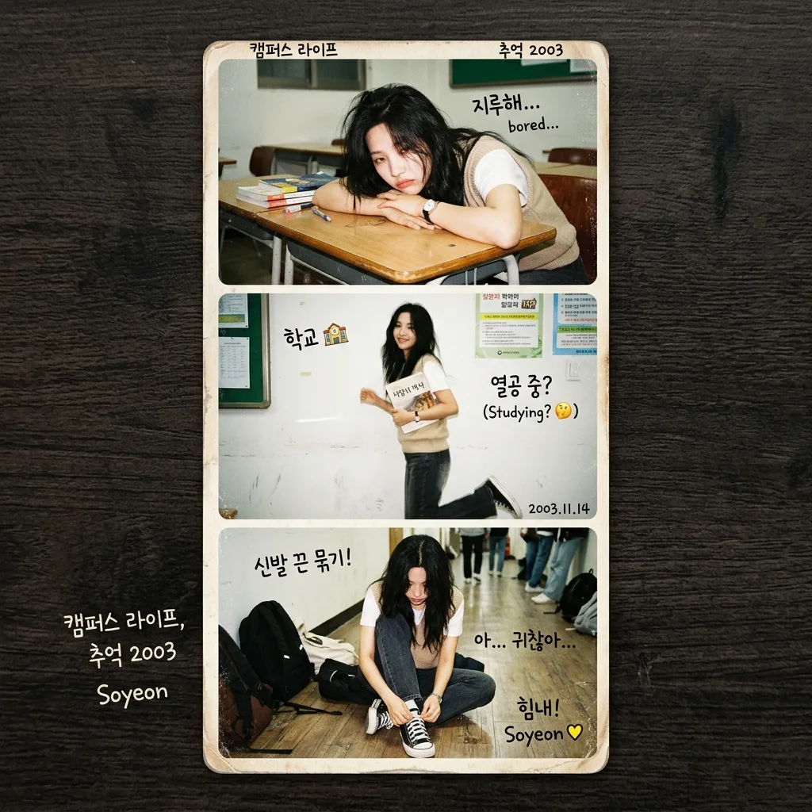

# Vertical 3-panel college photo strip

[← Back to the collection](../../README.md) · Category: [Photography](../../gallery/photography.md) · Model: `Vinano Image Pro` · ID: `vn-01842`

<a href="https://vinano.ai?utm_source=github&utm_medium=readme&utm_campaign=awesome-image-video-prompts-updating&utm_content=prompt-page-image"></a>

<sub>Preview generated with <a href="https://vinano.ai?utm_source=github&utm_medium=readme&utm_campaign=awesome-image-video-prompts-updating&utm_content=prompt-page-caption">vinano.ai</a></sub>

## Prompt

```text
A vertical 3-panel college photo strip. The subject is a girl long hair in a beige knit vest. Panel 1(top): close up of her resting chin on the school desk, looking bored. Panel 2(middle): her standing against a white class wall, holding a book, slightly motion blur. Panel 3(Bottom): sitting on the wooden floor, trying shoelace. Aesthetic: Korean 2000s phone -camera quality, s' arm tint, slightly low resolution ow handwritten doodle overlay, Harsh flash, messy i'm korean girl Aim for an editorial, design-driven look with deliberate negative space.
```

## Try it on vinano.ai

1. Copy the prompt above.
2. Open **[vinano.ai](https://vinano.ai?utm_source=github&utm_medium=readme&utm_campaign=awesome-image-video-prompts-updating&utm_content=prompt-page-try)**, paste it into the image generator and pick a model.
3. Swap any placeholders (brand, product, city, person…) for your own details, then generate.

More prompts like this: [Photography gallery](../../gallery/photography.md) · [all categories](../../README.md#contents)
