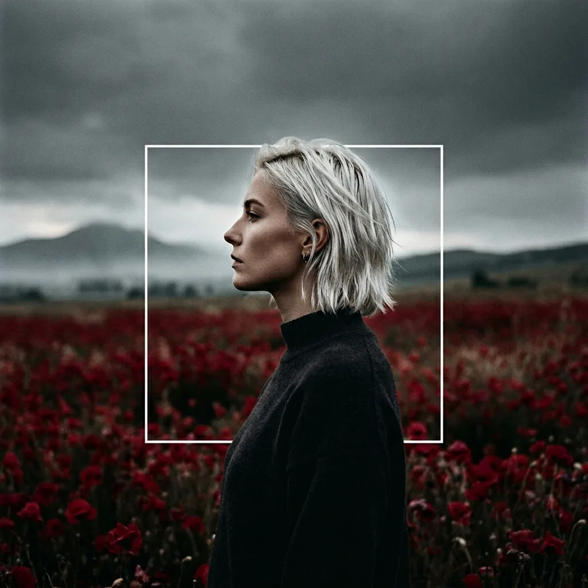

# Portrait, Cinematic

[← Back to the collection](../../README.md) · Category: [Photography](../../gallery/photography.md) · Model: `Vinano Image Pro` · ID: `vn-01893`

<a href="https://vinano.ai?utm_source=github&utm_medium=readme&utm_campaign=awesome-image-video-prompts-updating&utm_content=prompt-page-image"></a>

<sub>Preview generated with <a href="https://vinano.ai?utm_source=github&utm_medium=readme&utm_campaign=awesome-image-video-prompts-updating&utm_content=prompt-page-caption">vinano.ai</a></sub>

## Prompt

```text
A cinematic, high-contrast profile portrait of a woman short, platinum-blonde hair, standing in a vast field of deep crimson flowers. The scene is set under a heavy, overcast grey sky a moody, melancholic atmosphere. A thin, white rectangular frame is superimposed in the center of the composition; the woman's head and shoulders overlap and break the top and bottom edges of the frame for a modern, artistic effect. The lighting is soft and diffused from behind, creating a subtle rim light on her profile and hair. The foreground flowers are softly blurred a shallow depth of field, and a faint, misty mountain silhouette is visible in the distant background. High-grain, filmic aesthetic. Aim for an editorial, design-driven look with deliberate negative space.
```

## Try it on vinano.ai

1. Copy the prompt above.
2. Open **[vinano.ai](https://vinano.ai?utm_source=github&utm_medium=readme&utm_campaign=awesome-image-video-prompts-updating&utm_content=prompt-page-try)**, paste it into the image generator and pick a model.
3. Swap any placeholders (brand, product, city, person…) for your own details, then generate.

More prompts like this: [Photography gallery](../../gallery/photography.md) · [all categories](../../README.md#contents)
