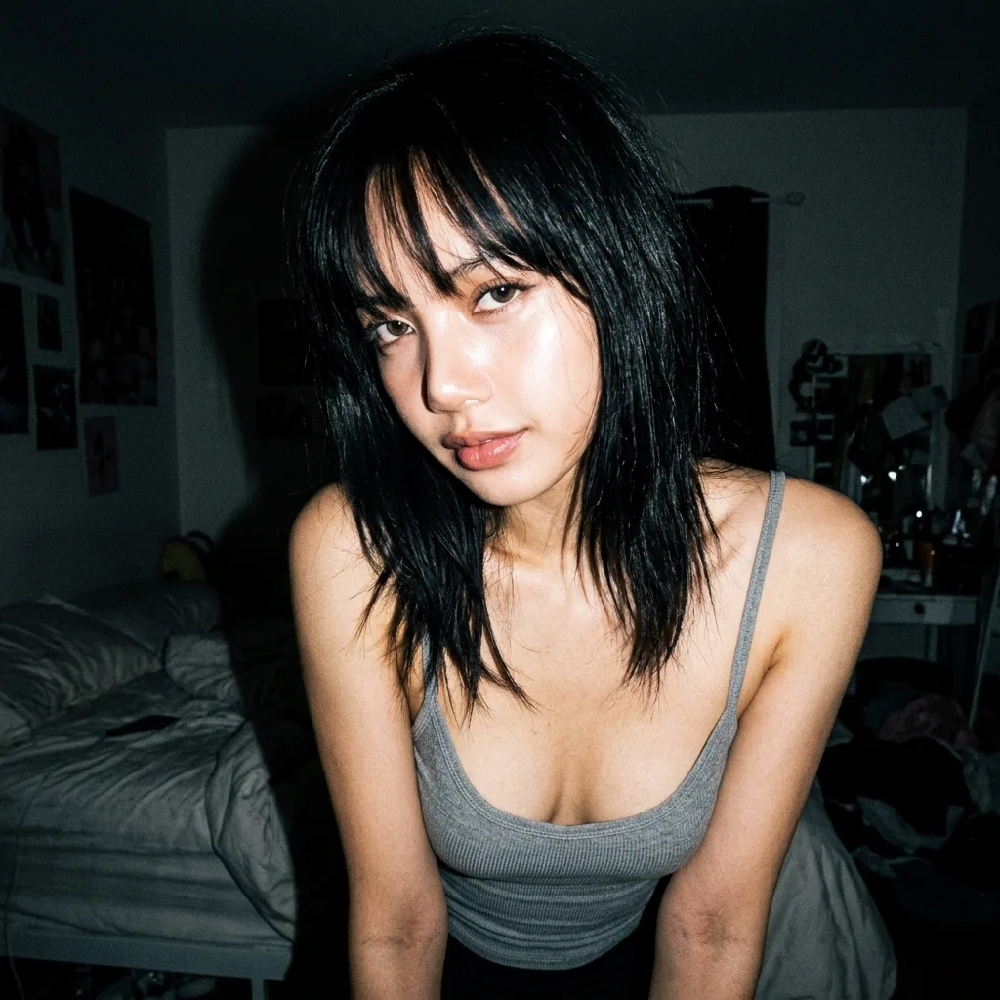

# IPhone 17 Pro , lens

[← Back to the collection](../../README.md) · Category: [Photography](../../gallery/photography.md) · Model: `Vinano Image Pro` · ID: `vn-01917`

<a href="https://vinano.ai?utm_source=github&utm_medium=readme&utm_campaign=awesome-image-video-prompts-updating&utm_content=prompt-page-image"></a>

<sub>Preview generated with <a href="https://vinano.ai?utm_source=github&utm_medium=readme&utm_campaign=awesome-image-video-prompts-updating&utm_content=prompt-page-caption">vinano.ai</a></sub>

## Prompt

```text
{
  "meta": {
    "camera": "iPhone 17 Pro",
    "lens": "24mm",
    "aspect_ratio": "9:16",
    "style": "iphone flash shot, raw, high contrast, no editing"
  },

  "scene": {
    "location": "dim bedroom",
    "time": "night",
    "atmosphere": "late night, slightly chaotic calm"
  },

  "lighting": {
    "primary": "iphone flash",
    "secondary": "very dim ambient",
    "temperature": "neutral",
    "effect": ["sharp highlights on face",
      "deep background shadows",
      "glossy skin reflections"]
  },

  "camera": {
    "angle": "close and slightly low",
    "distance": "face + upper torso",
    "framing": "tight crop, imperfect"
  },

  "subject": {
    "identity": "BLACKPINK Lisa inspired, bold gaze, clean features",
    "pose": {
      "position": "leaning slightly toward camera",
      "shoulders": "relaxed"
    },
    "expression": {
      "eyes": "direct, intense, slightly teasing",
      "lips": "soft but controlled"
    },
    "hair": {
      "style": "slightly messy straight hair bangs"
    },
    "outfit": {
      "top": {
        "type": "thin strap top",
        "color": "grey",
        "fit": "tight minimal"
      }
    }
  },

  "iphone_realism": {
    "imperfections": ["flash blowout",
      "grain",
      "lens distortion"]
  }
}

Aim for an editorial, design-driven look with deliberate negative space.
```

## Try it on vinano.ai

1. Copy the prompt above.
2. Open **[vinano.ai](https://vinano.ai?utm_source=github&utm_medium=readme&utm_campaign=awesome-image-video-prompts-updating&utm_content=prompt-page-try)**, paste it into the image generator and pick a model.
3. Swap any placeholders (brand, product, city, person…) for your own details, then generate.

More prompts like this: [Photography gallery](../../gallery/photography.md) · [all categories](../../README.md#contents)
