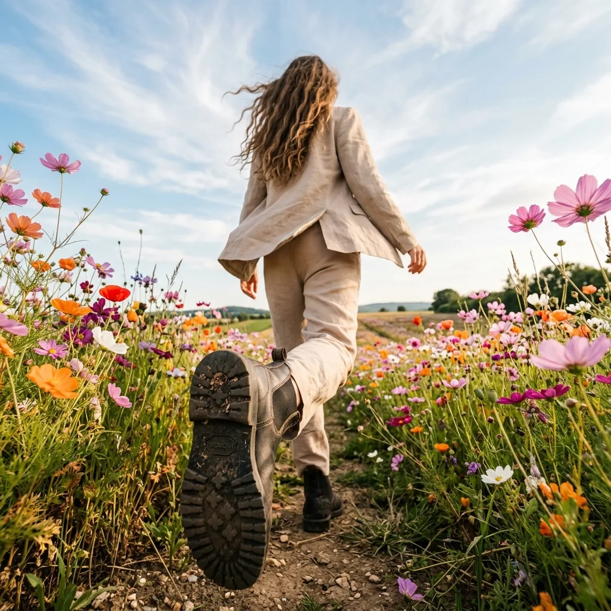

# Realistic, Cinematic

[← Back to the collection](../../README.md) · Category: [Photography](../../gallery/photography.md) · Model: `Vinano Image Pro` · ID: `vn-01932`

<a href="https://vinano.ai?utm_source=github&utm_medium=readme&utm_campaign=awesome-image-video-prompts-updating&utm_content=prompt-page-image"></a>

<sub>Preview generated with <a href="https://vinano.ai?utm_source=github&utm_medium=readme&utm_campaign=awesome-image-video-prompts-updating&utm_content=prompt-page-caption">vinano.ai</a></sub>

## Prompt

```text
A cinematic ultra-wide low-angle shot of a stylish young woman walking through a vibrant flower field, captured from ground level as if the camera is beneath her foot mid-step. The sole of her shoe dominates the foreground sharp detail, creating a dramatic perspective. She wears a soft beige outfit a light jacket, her long hair flowing naturally in the wind. Surrounding her are colorful blooming flowers (cosmos and wildflowers) framing the scene. The sky above is bright blue soft clouds, creating a dreamy, airy atmosphere. Natural sunlight, soft shadows, high fashion editorial style, ultra-realistic, shallow depth of field, 8K detail Render with rich micro-detail while keeping the layout uncluttered and intentional.
```

## Try it on vinano.ai

1. Copy the prompt above.
2. Open **[vinano.ai](https://vinano.ai?utm_source=github&utm_medium=readme&utm_campaign=awesome-image-video-prompts-updating&utm_content=prompt-page-try)**, paste it into the image generator and pick a model.
3. Swap any placeholders (brand, product, city, person…) for your own details, then generate.

More prompts like this: [Photography gallery](../../gallery/photography.md) · [all categories](../../README.md#contents)
