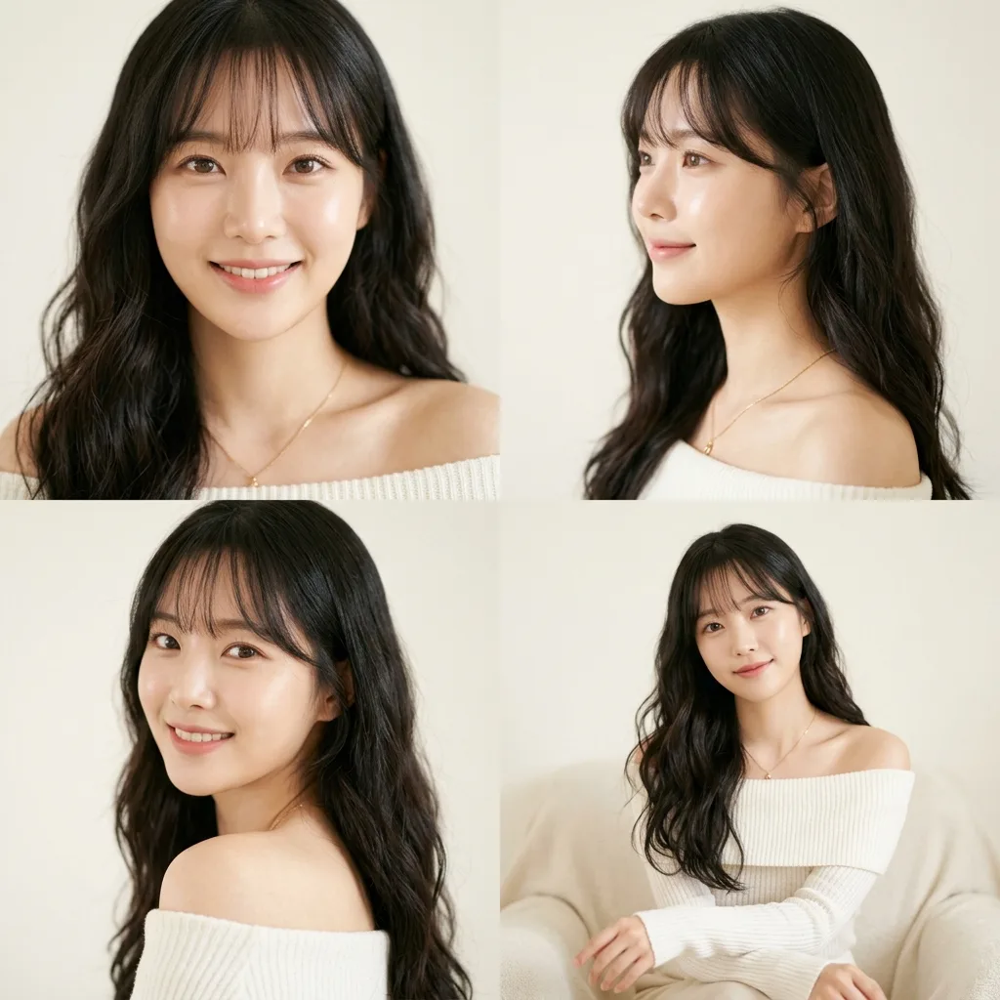

# Realistic, Portrait

[← Back to the collection](../../README.md) · Category: [Photography](../../gallery/photography.md) · Model: `Vinano Image v2` · ID: `vn-01965`

<a href="https://vinano.ai?utm_source=github&utm_medium=readme&utm_campaign=awesome-image-video-prompts-updating&utm_content=prompt-page-image"></a>

<sub>Preview generated with <a href="https://vinano.ai?utm_source=github&utm_medium=readme&utm_campaign=awesome-image-video-prompts-updating&utm_content=prompt-page-caption">vinano.ai</a></sub>

## Prompt

```text
true-to-life photorealistic Korean beauty portrait of a cute young woman long wavy dark hair and soft wispy bangs, natural glowing fair skin, delicate features, subtle smile, and warm expressive eyes. Wearing a cozy off-shoulder white knit top and a delicate necklace. Soft natural daylight, clean cream background, minimal aesthetic, elegant and feminine vibe. Multiple poses including direct eye contact, side profile, over-the-shoulder glance, and relaxed seated pose. Ultra-realistic skin texture, detailed hair strands, shallow depth of field, soft tones, high-end lifestyle photography, dreamy and effortless beauty, 4k quality. Maintain consistent colour harmony and crisp focus across the whole frame.
```

## Try it on vinano.ai

1. Copy the prompt above.
2. Open **[vinano.ai](https://vinano.ai?utm_source=github&utm_medium=readme&utm_campaign=awesome-image-video-prompts-updating&utm_content=prompt-page-try)**, paste it into the image generator and pick a model.
3. Swap any placeholders (brand, product, city, person…) for your own details, then generate.

More prompts like this: [Photography gallery](../../gallery/photography.md) · [all categories](../../README.md#contents)
