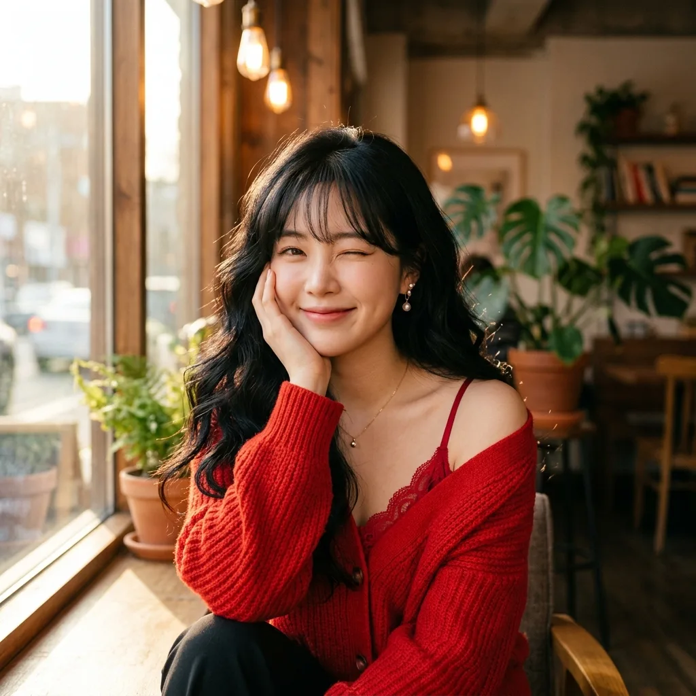

# Realistic, Portrait

[← Back to the collection](../../README.md) · Category: [Photography](../../gallery/photography.md) · Model: `Vinano Image v2` · ID: `vn-01994`

<a href="https://vinano.ai?utm_source=github&utm_medium=readme&utm_campaign=awesome-image-video-prompts-updating&utm_content=prompt-page-image"></a>

<sub>Preview generated with <a href="https://vinano.ai?utm_source=github&utm_medium=readme&utm_campaign=awesome-image-video-prompts-updating&utm_content=prompt-page-caption">vinano.ai</a></sub>

## Prompt

```text
Ultra-detailed portrait of a beautiful young East Asian woman sitting indoors beside a large sunlit window during golden hour. Long, voluminous wavy black hair cascading over her shoulders, soft wispy bangs partially covering one eye. Flawless porcelain skin a natural glow, subtle blush, glossy pink lips, delicate facial features, expressive brown eyes. Playful and charming expression a gentle smile and one eye winking at the camera. One hand resting against her cheek, creating a relaxed and intimate pose.
She wears a vibrant oversized red knit cardigan slipping off one shoulder, revealing a delicate red lace camisole underneath. Minimal elegant jewelry including a small pendant necklace and pearl drop earrings. Warm sunlight streams through the window, creating beautiful rim lighting in her hair and soft highlights on her face.
Cozy modern café or apartment interior in the background hanging Edison bulbs, wooden furniture, houseplants, and creamy neutral tones. Shallow depth of field, dreamy bokeh lights, cinematic atmosphere, soft natural lighting, ultra-realistic skin texture, high-end fashion photography, professional portrait lens, 85mm, f/1.4, HDR, warm color grading, true-to-life photorealistic, highly detailed, magazine-quality portrait, vertical composition, 3:4 aspect ratio.

Keep edges clean and the overall composition balanced for a polished, gallery-ready result.
```

## Try it on vinano.ai

1. Copy the prompt above.
2. Open **[vinano.ai](https://vinano.ai?utm_source=github&utm_medium=readme&utm_campaign=awesome-image-video-prompts-updating&utm_content=prompt-page-try)**, paste it into the image generator and pick a model.
3. Swap any placeholders (brand, product, city, person…) for your own details, then generate.

More prompts like this: [Photography gallery](../../gallery/photography.md) · [all categories](../../README.md#contents)
