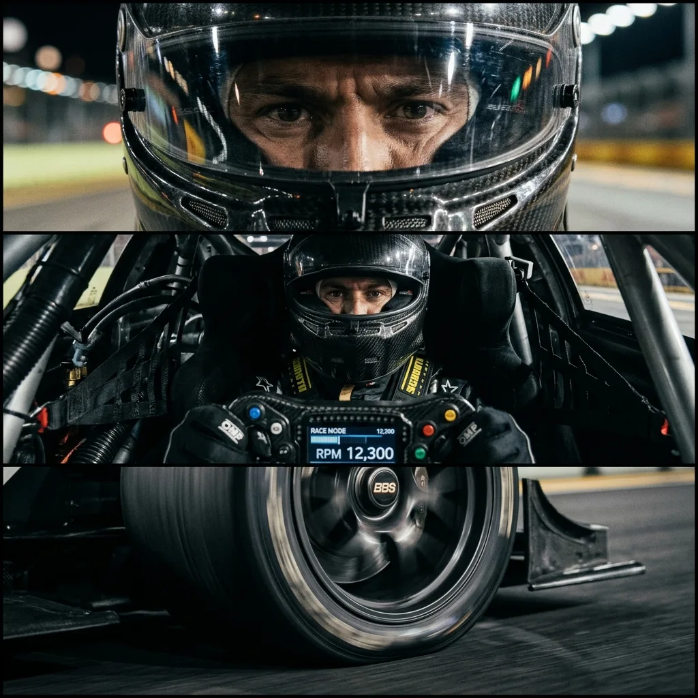

# Cinematic, Ai Art

[← Back to the collection](../../README.md) · Category: [Photography](../../gallery/photography.md) · Model: `Vinano Image Pro` · ID: `vn-02018`

<a href="https://vinano.ai?utm_source=github&utm_medium=readme&utm_campaign=awesome-image-video-prompts-updating&utm_content=prompt-page-image"></a>

<sub>Preview generated with <a href="https://vinano.ai?utm_source=github&utm_medium=readme&utm_campaign=awesome-image-video-prompts-updating&utm_content=prompt-page-caption">vinano.ai</a></sub>

## Prompt

```text
Create a cohesive 3-panel editorial layout, stacked horizontally (top, middle, bottom panels).All panels are close-shot only, no wide scenes, no background storytelling — cinematic editorial photography consistent lighting, color grading, and lens language.Top panel: Extreme close-up of a race driver’s eyes behind a helmet visor, sharp focus, reflections of track lights in the visor, intense concentration, shallow depth of field.Middle panel: Low-angle close-up from inside the cockpit, camera looking upward at the driver, helmeted face dominant, hands gripping the steering wheel, tight confined space, raw pressure and speed implied.Bottom panel: Extreme close-up of a racing car wheel in motion, visible tire deformation, heat and rubber texture, strong motion blur, pure mechanical energy.Editorial magazine style, cinematic realism, high contrast, minimal distractions, unified visual rhythm across all panels. Emphasise material texture and natural light so the final frame feels tactile and premium.
```

## Try it on vinano.ai

1. Copy the prompt above.
2. Open **[vinano.ai](https://vinano.ai?utm_source=github&utm_medium=readme&utm_campaign=awesome-image-video-prompts-updating&utm_content=prompt-page-try)**, paste it into the image generator and pick a model.
3. Swap any placeholders (brand, product, city, person…) for your own details, then generate.

More prompts like this: [Photography gallery](../../gallery/photography.md) · [all categories](../../README.md#contents)
