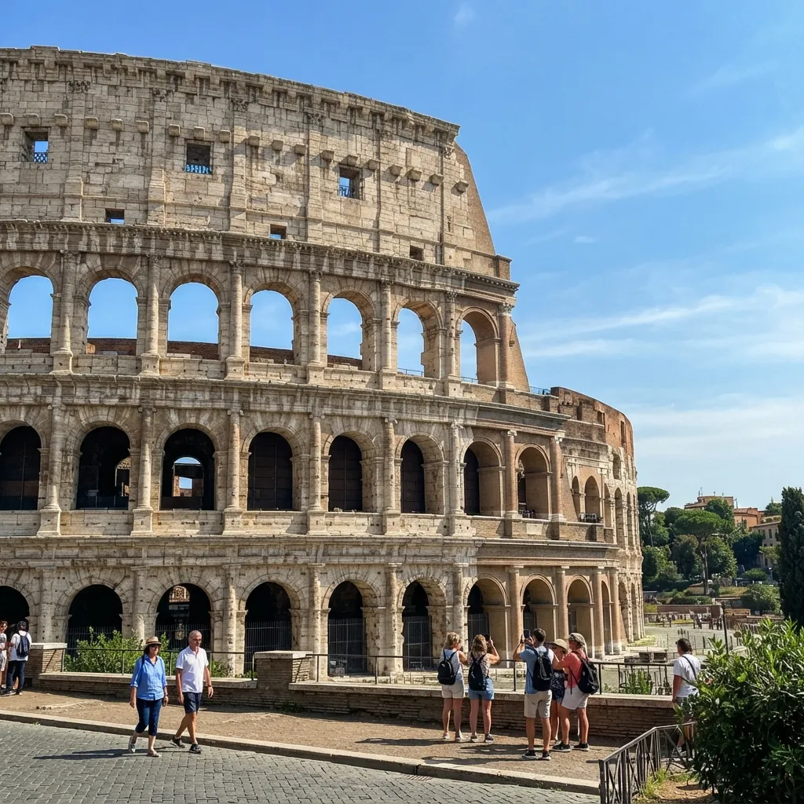

# Travel photo of the Colosseum in Rome

[← Back to the collection](../../README.md) · Category: [Photography](../../gallery/photography.md) · Model: `Nano Banana` · ID: `vn-02039`

<a href="https://vinano.ai?utm_source=github&utm_medium=readme&utm_campaign=awesome-image-video-prompts-updating&utm_content=prompt-page-image"></a>

<sub>Preview generated with <a href="https://vinano.ai?utm_source=github&utm_medium=readme&utm_campaign=awesome-image-video-prompts-updating&utm_content=prompt-page-caption">vinano.ai</a> · added 2026-11-18</sub>

## Prompt

```text
Realistic travel photo of the Colosseum in Rome on a sunny day, three-quarter exterior view showing the arches of the outer wall and the lower inner ring, blue sky, a few tourists in the foreground, natural colours, shot on a phone, square 1:1 framing, no text.
```

## Try it on vinano.ai

1. Copy the prompt above.
2. Open **[vinano.ai](https://vinano.ai?utm_source=github&utm_medium=readme&utm_campaign=awesome-image-video-prompts-updating&utm_content=prompt-page-try)**, paste it into the image generator and pick a model.
3. Swap any placeholders (brand, product, city, person…) for your own details, then generate.

More prompts like this: [Photography gallery](../../gallery/photography.md) · [all categories](../../README.md#contents)
