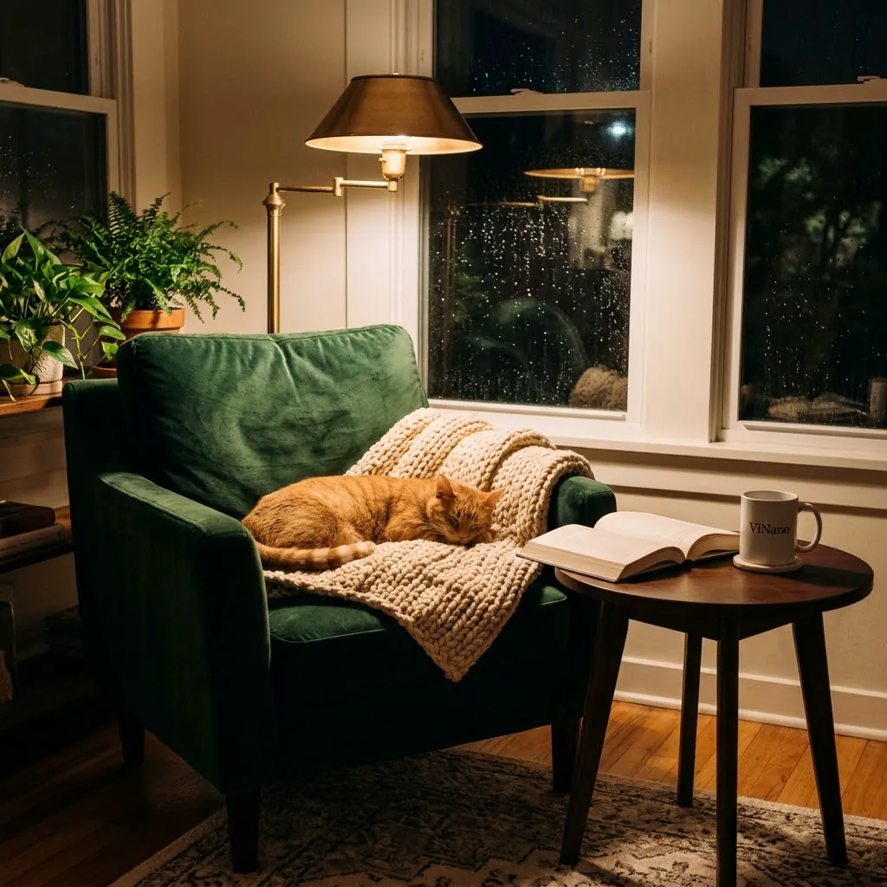

# Cozy reading corner at night

[← Back to the collection](../../README.md) · Category: [Photography](../../gallery/photography.md) · Model: `Nano Banana 2` · ID: `vn-02041`

<a href="https://vinano.ai?utm_source=github&utm_medium=readme&utm_campaign=awesome-image-video-prompts-updating&utm_content=prompt-page-image"></a>

<sub>Preview generated with <a href="https://vinano.ai?utm_source=github&utm_medium=readme&utm_campaign=awesome-image-video-prompts-updating&utm_content=prompt-page-caption">vinano.ai</a> · added 2026-11-18</sub>

## Prompt

```text
A cozy reading corner at night: a green velvet armchair, a brass floor lamp casting warm light, a wooden side table with a white ceramic mug printed with the word 'ViNano', an open hardcover book, an orange cat asleep on a knitted blanket, rain on the window behind. Photorealistic interior photo.
```

## Try it on vinano.ai

1. Copy the prompt above.
2. Open **[vinano.ai](https://vinano.ai?utm_source=github&utm_medium=readme&utm_campaign=awesome-image-video-prompts-updating&utm_content=prompt-page-try)**, paste it into the image generator and pick a model.
3. Swap any placeholders (brand, product, city, person…) for your own details, then generate.

More prompts like this: [Photography gallery](../../gallery/photography.md) · [all categories](../../README.md#contents)
