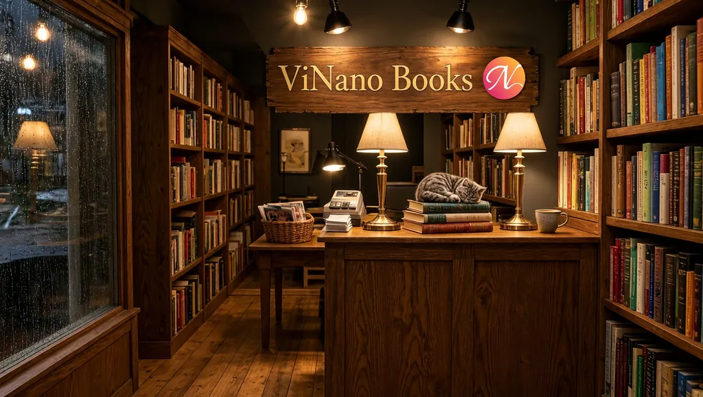

# Interior of a cozy independent bookstore on a rainy

[← Back to the collection](../../README.md) · Category: [Photography](../../gallery/photography.md) · Model: `MiniMax H3 Image` · ID: `vn-02042`

<a href="https://vinano.ai?utm_source=github&utm_medium=readme&utm_campaign=awesome-image-video-prompts-updating&utm_content=prompt-page-image"></a>

<sub>Preview generated with <a href="https://vinano.ai?utm_source=github&utm_medium=readme&utm_campaign=awesome-image-video-prompts-updating&utm_content=prompt-page-caption">vinano.ai</a> · added 2026-11-18</sub>

## Prompt

```text
Photorealistic interior of a cozy independent bookstore on a rainy evening. Above the counter hangs a carved wooden sign that reads "ViNano Books", and next to the text is a round logo: a pink-to-orange gradient circle with a white flowing letter N. Warm tungsten lamps, tall shelves of colorful book spines, a cat sleeping on a stack of novels, rain streaks on the front window, 35mm lens, natural colors.
```

## Try it on vinano.ai

1. Copy the prompt above.
2. Open **[vinano.ai](https://vinano.ai?utm_source=github&utm_medium=readme&utm_campaign=awesome-image-video-prompts-updating&utm_content=prompt-page-try)**, paste it into the image generator and pick a model.
3. Swap any placeholders (brand, product, city, person…) for your own details, then generate.

More prompts like this: [Photography gallery](../../gallery/photography.md) · [all categories](../../README.md#contents)
