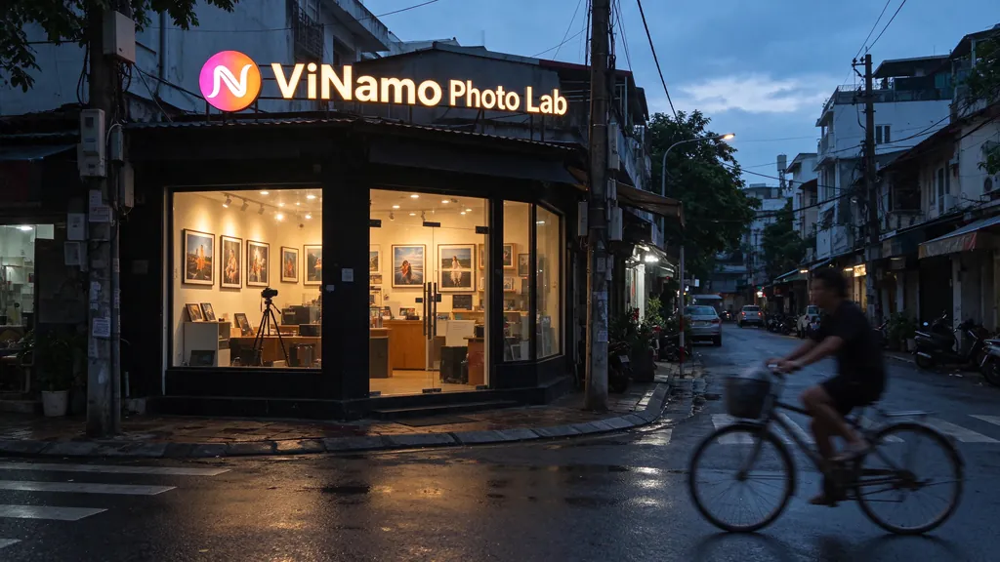

# Street photo at blue hour

[← Back to the collection](../../README.md) · Category: [Photography](../../gallery/photography.md) · Model: `Seedream 5.5` · ID: `vn-02043`

<a href="https://vinano.ai?utm_source=github&utm_medium=readme&utm_campaign=awesome-image-video-prompts-updating&utm_content=prompt-page-image"></a>

<sub>Preview generated with <a href="https://vinano.ai?utm_source=github&utm_medium=readme&utm_campaign=awesome-image-video-prompts-updating&utm_content=prompt-page-caption">vinano.ai</a> · added 2026-11-18</sub>

## Prompt

```text
Photorealistic street photo at blue hour: a small corner photo studio with a large illuminated shop sign that reads "ViNano Photo Lab". Next to the text is a round logo: a circle with a pink-to-orange gradient and a white flowing letter N. Warm light from the shop windows shows framed prints and a camera on a tripod inside. Wet pavement with reflections, a cyclist passing by with slight motion blur, 35mm lens, realistic colors.
```

## Try it on vinano.ai

1. Copy the prompt above.
2. Open **[vinano.ai](https://vinano.ai?utm_source=github&utm_medium=readme&utm_campaign=awesome-image-video-prompts-updating&utm_content=prompt-page-try)**, paste it into the image generator and pick a model.
3. Swap any placeholders (brand, product, city, person…) for your own details, then generate.

More prompts like this: [Photography gallery](../../gallery/photography.md) · [all categories](../../README.md#contents)
