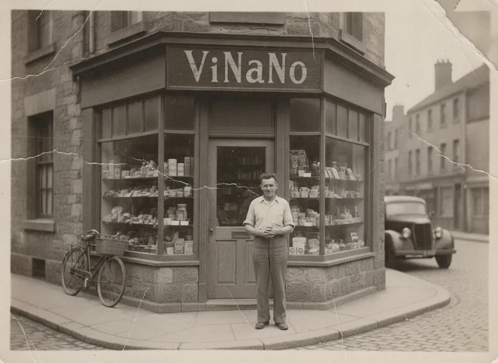

# Old, faded, scratched black-and-white photograph from the 1950s

[← Back to the collection](../../README.md) · Category: [Photography](../../gallery/photography.md) · Model: `Nano Banana` · ID: `vn-02048`

<a href="https://vinano.ai?utm_source=github&utm_medium=readme&utm_campaign=awesome-image-video-prompts-updating&utm_content=prompt-page-image"></a>

<sub>Preview generated with <a href="https://vinano.ai?utm_source=github&utm_medium=readme&utm_campaign=awesome-image-video-prompts-updating&utm_content=prompt-page-caption">vinano.ai</a> · added 2026-11-18</sub>

## Prompt

```text
An old, faded, scratched black-and-white photograph from the 1950s of a small family-run shop with a hand-painted sign that reads "ViNano" above the door and a shopkeeper standing in front, with creases, dust spots and a torn corner.
```

## Try it on vinano.ai

1. Copy the prompt above.
2. Open **[vinano.ai](https://vinano.ai?utm_source=github&utm_medium=readme&utm_campaign=awesome-image-video-prompts-updating&utm_content=prompt-page-try)**, paste it into the image generator and pick a model.
3. Swap any placeholders (brand, product, city, person…) for your own details, then generate.

More prompts like this: [Photography gallery](../../gallery/photography.md) · [all categories](../../README.md#contents)
