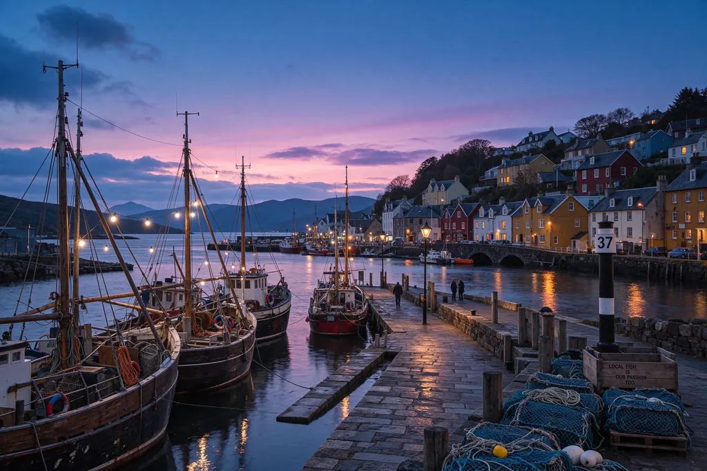

# Fishing Harbor in Blue Hour

[← Back to the collection](../../README.md) · Category: [Photography](../../gallery/photography.md) · Model: `Seedream 5.5` · ID: `vn-02168`

<a href="https://vinano.ai?utm_source=github&utm_medium=readme&utm_campaign=awesome-image-video-prompts-updating&utm_content=prompt-page-image"></a>

<sub>Preview generated with <a href="https://vinano.ai?utm_source=github&utm_medium=readme&utm_campaign=awesome-image-video-prompts-updating&utm_content=prompt-page-caption">vinano.ai</a> · added 2026-11-24</sub>

## Prompt

```text
A wide photograph of a small fishing harbor at blue hour: rows of weathered wooden boats moored along a stone quay, string lights on the masts reflecting in calm water, stacked nets and buoys in the foreground, colorful houses on the hillside with lit windows. Long exposure smooths the water, deep blue sky fading to violet near the horizon, natural color, fine detail.
```

## Try it on vinano.ai

1. Copy the prompt above.
2. Open **[vinano.ai](https://vinano.ai?utm_source=github&utm_medium=readme&utm_campaign=awesome-image-video-prompts-updating&utm_content=prompt-page-try)**, paste it into the image generator and pick a model.
3. Swap any placeholders (brand, product, city, person…) for your own details, then generate.

More prompts like this: [Photography gallery](../../gallery/photography.md) · [all categories](../../README.md#contents)
