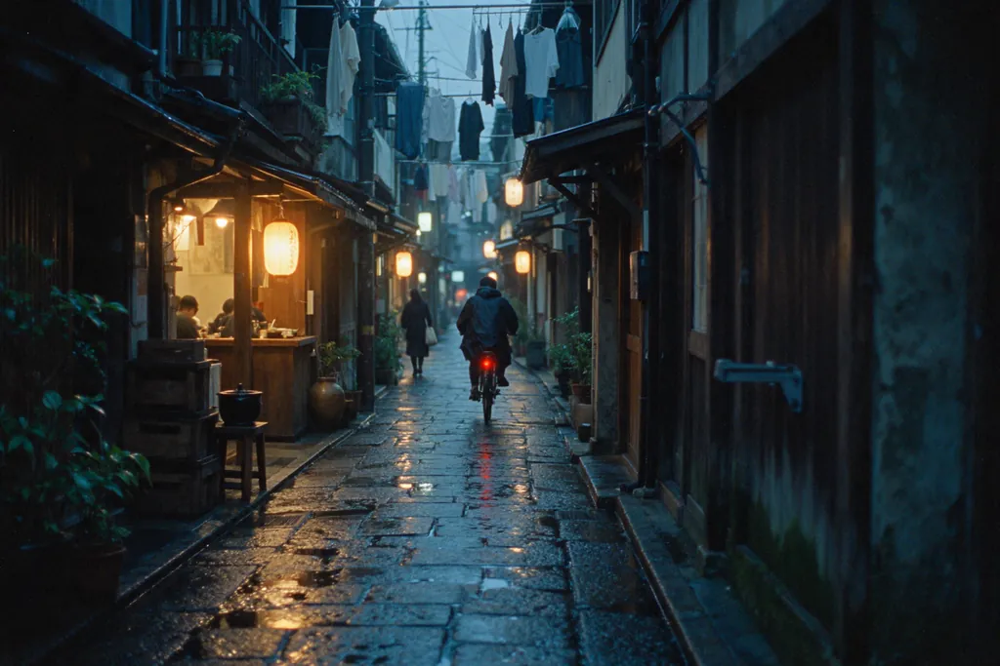

# Rainy Harbor Alley at Blue Hour

[← Back to the collection](../../README.md) · Category: [Photography](../../gallery/photography.md) · Model: `Seedream 5.5` · ID: `vn-02188`

<a href="https://vinano.ai?utm_source=github&utm_medium=readme&utm_campaign=awesome-image-video-prompts-updating&utm_content=prompt-page-image"></a>

<sub>Preview generated with <a href="https://vinano.ai?utm_source=github&utm_medium=readme&utm_campaign=awesome-image-video-prompts-updating&utm_content=prompt-page-caption">vinano.ai</a> · added 2026-11-26</sub>

## Prompt

```text
Cinematic street photograph of a narrow rain-soaked alley in an old harbor town at blue hour, shot at eye level with a 35mm lens. Warm lantern light spills from a tiny noodle bar onto wet cobblestones, a cyclist in a dark raincoat passes with a blurred rear light, laundry lines and potted plants overhead, reflections shimmering in the puddles. Teal and amber color grade, fine film grain, natural depth, quiet atmospheric mood, no readable signs.
```

## Try it on vinano.ai

1. Copy the prompt above.
2. Open **[vinano.ai](https://vinano.ai?utm_source=github&utm_medium=readme&utm_campaign=awesome-image-video-prompts-updating&utm_content=prompt-page-try)**, paste it into the image generator and pick a model.
3. Swap any placeholders (brand, product, city, person…) for your own details, then generate.

More prompts like this: [Photography gallery](../../gallery/photography.md) · [all categories](../../README.md#contents)
