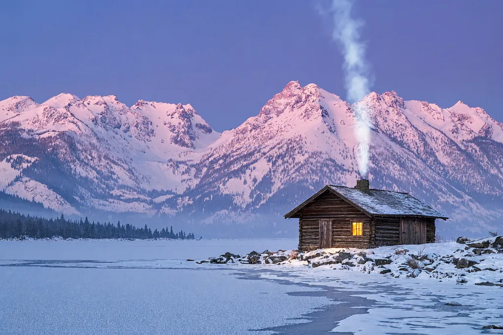

# Frozen Mountain Lake Cabin at Dawn

[← Back to the collection](../../README.md) · Category: [Photography](../../gallery/photography.md) · Model: `MiniMax H3 Image` · ID: `vn-02197`

<a href="https://vinano.ai?utm_source=github&utm_medium=readme&utm_campaign=awesome-image-video-prompts-updating&utm_content=prompt-page-image"></a>

<sub>Preview generated with <a href="https://vinano.ai?utm_source=github&utm_medium=readme&utm_campaign=awesome-image-video-prompts-updating&utm_content=prompt-page-caption">vinano.ai</a> · added 2026-11-27</sub>

## Prompt

```text
Wide landscape photograph of a lone wooden cabin on the shore of a frozen mountain lake at dawn. Pink and violet alpenglow lights the snowy peaks behind, the ice shows cracked blue patterns and a dusting of snow, a thin line of smoke rises from the chimney and a single warm window glows. Long-lens compression, crisp cold air, subtle mist over the far shore, natural colors, high dynamic range, fine detail, National-Geographic-style travel photo.
```

## Try it on vinano.ai

1. Copy the prompt above.
2. Open **[vinano.ai](https://vinano.ai?utm_source=github&utm_medium=readme&utm_campaign=awesome-image-video-prompts-updating&utm_content=prompt-page-try)**, paste it into the image generator and pick a model.
3. Swap any placeholders (brand, product, city, person…) for your own details, then generate.

More prompts like this: [Photography gallery](../../gallery/photography.md) · [all categories](../../README.md#contents)
