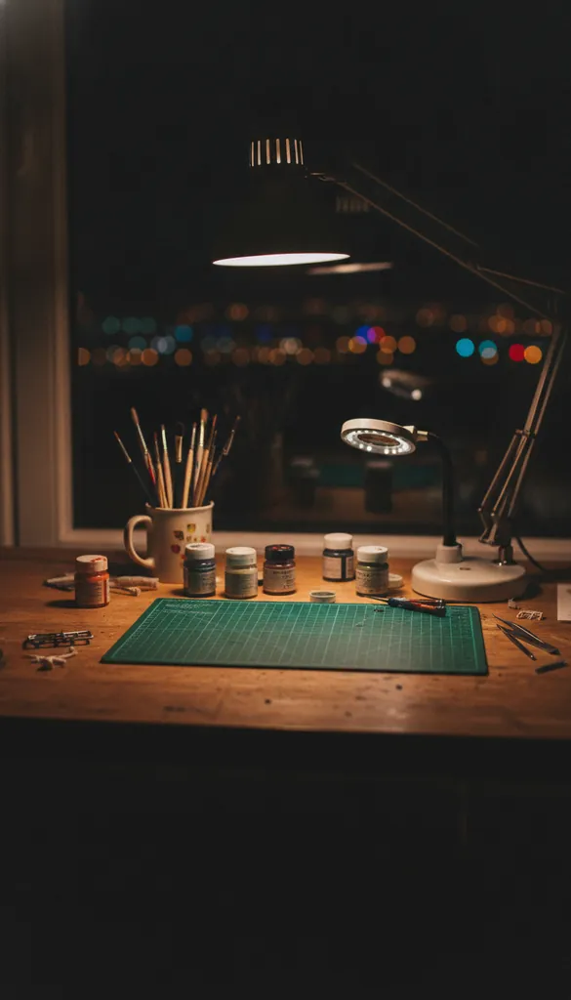

# Model Maker's Workbench at Night

[← Back to the collection](../../README.md) · Category: [Photography](../../gallery/photography.md) · Model: `Nano Banana` · ID: `vn-02211`

<a href="https://vinano.ai?utm_source=github&utm_medium=readme&utm_campaign=awesome-image-video-prompts-updating&utm_content=prompt-page-image"></a>

<sub>Preview generated with <a href="https://vinano.ai?utm_source=github&utm_medium=readme&utm_campaign=awesome-image-video-prompts-updating&utm_content=prompt-page-caption">vinano.ai</a> · added 2026-11-28</sub>

## Prompt

```text
Vertical photo of a model maker's wooden workbench at night, seen from desk level and lit by one warm articulated desk lamp: a green cutting mat, small glass jars of paint, fine brushes standing in a mug, tweezers, a magnifying lamp, tiny screwdrivers, scattered plastic sprues, and a dark window with soft city bokeh behind. The middle of the cutting mat is empty. No people, no boxes, no text, no logos. Photorealistic, shallow depth of field, cinematic.
```

## Try it on vinano.ai

1. Copy the prompt above.
2. Open **[vinano.ai](https://vinano.ai?utm_source=github&utm_medium=readme&utm_campaign=awesome-image-video-prompts-updating&utm_content=prompt-page-try)**, paste it into the image generator and pick a model.
3. Swap any placeholders (brand, product, city, person…) for your own details, then generate.

More prompts like this: [Photography gallery](../../gallery/photography.md) · [all categories](../../README.md#contents)
