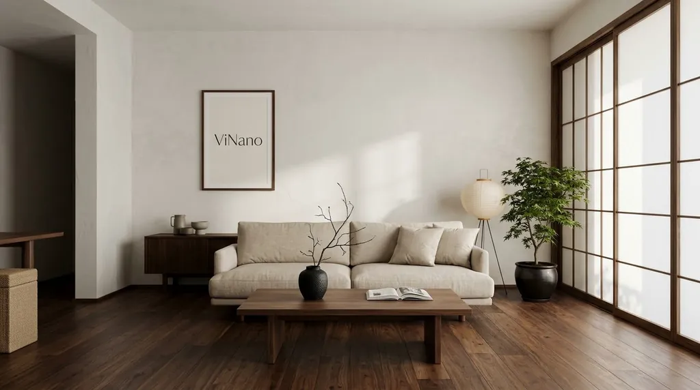

# Japandi Living Room Interior

[← Back to the collection](../../README.md) · Category: [Photography](../../gallery/photography.md) · Model: `Nano Banana Pro` · ID: `vn-02213`

<a href="https://vinano.ai?utm_source=github&utm_medium=readme&utm_campaign=awesome-image-video-prompts-updating&utm_content=prompt-page-image"></a>

<sub>Preview generated with <a href="https://vinano.ai?utm_source=github&utm_medium=readme&utm_campaign=awesome-image-video-prompts-updating&utm_content=prompt-page-caption">vinano.ai</a> · added 2026-11-28</sub>

## Prompt

```text
Japandi living room interior design, warm white plaster walls, dark walnut hardwood flooring, low linen sofa in oatmeal, rectangular solid walnut coffee table, a single ikebana branch in a black ceramic vase, shoji-style sliding panels letting in soft natural daylight, a framed minimalist poster on the wall with the word "ViNano" in thin black letters, restrained palette of walnut, oatmeal and black, architectural photography style.
```

## Try it on vinano.ai

1. Copy the prompt above.
2. Open **[vinano.ai](https://vinano.ai?utm_source=github&utm_medium=readme&utm_campaign=awesome-image-video-prompts-updating&utm_content=prompt-page-try)**, paste it into the image generator and pick a model.
3. Swap any placeholders (brand, product, city, person…) for your own details, then generate.

More prompts like this: [Photography gallery](../../gallery/photography.md) · [all categories](../../README.md#contents)
