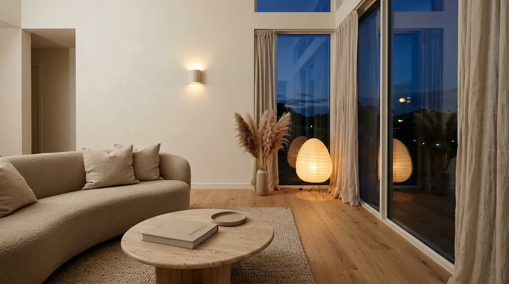

# Warm Minimalist Living Room at Dusk

[← Back to the collection](../../README.md) · Category: [Photography](../../gallery/photography.md) · Model: `Nano Banana Pro` · ID: `vn-02214`

<a href="https://vinano.ai?utm_source=github&utm_medium=readme&utm_campaign=awesome-image-video-prompts-updating&utm_content=prompt-page-image"></a>

<sub>Preview generated with <a href="https://vinano.ai?utm_source=github&utm_medium=readme&utm_campaign=awesome-image-video-prompts-updating&utm_content=prompt-page-caption">vinano.ai</a> · added 2026-11-28</sub>

## Prompt

```text
Modern warm minimalist living room interior design at dusk, cream white walls, light oak hardwood flooring, curved beige boucle sofa, round travertine coffee table with a linen-bound book whose cover reads "ViNano", dried pampas grass in a ceramic vase, floor-to-ceiling windows with sheer linen curtains showing a deep blue evening sky, warm light from a paper floor lamp and a wall sconce, neutral palette with warm undertones, architectural photography style.
```

## Try it on vinano.ai

1. Copy the prompt above.
2. Open **[vinano.ai](https://vinano.ai?utm_source=github&utm_medium=readme&utm_campaign=awesome-image-video-prompts-updating&utm_content=prompt-page-try)**, paste it into the image generator and pick a model.
3. Swap any placeholders (brand, product, city, person…) for your own details, then generate.

More prompts like this: [Photography gallery](../../gallery/photography.md) · [all categories](../../README.md#contents)
