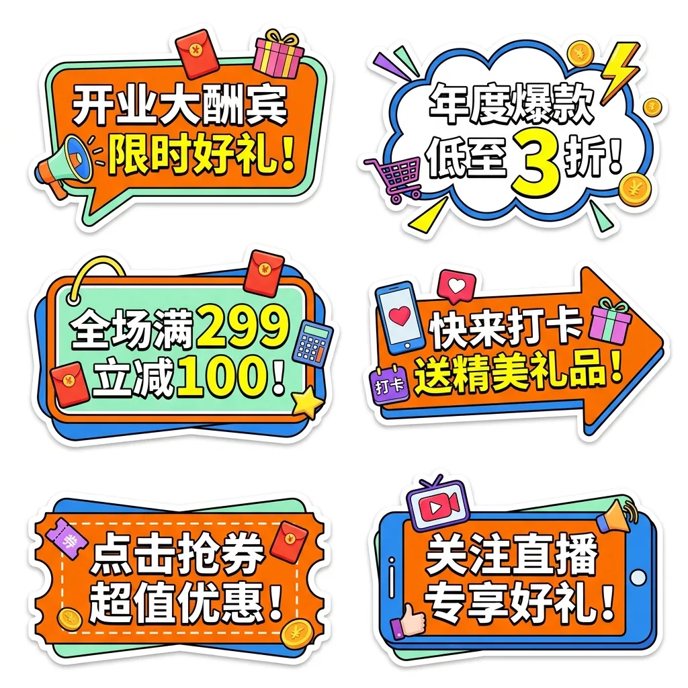

# 整张图里展示 6 个独立手举牌

[← Back to the collection](../../README.md) · Category: [Poster Design](../../gallery/poster-design.md) · Model: `Vinano Image Pro` · ID: `vn-00001`

<a href="https://vinano.ai?utm_source=github&utm_medium=readme&utm_campaign=awesome-image-video-prompts-updating&utm_content=prompt-page-image"></a>

<sub>Preview generated with <a href="https://vinano.ai?utm_source=github&utm_medium=readme&utm_campaign=awesome-image-video-prompts-updating&utm_content=prompt-page-caption">vinano.ai</a></sub>

## Prompt

```text
整张图里展示 6 个独立手举牌，每个手举牌都完整可见，彼此分开，不要重叠，不要合并成一个大牌，采用清晰的 2列×3行 排布，整体留白舒服，白色底干净整洁，突出每个手举牌本身。每个案例都是单独一张图，不要把多个案例合并在一起。

整体风格要求：参考高完成度商业促销手举牌物料风格，画面要有成熟商业感、原创性和较强细节，不要做得简陋，不要过于扁平，不要像幼儿园贴纸。每个手举牌都必须有明显的多层结构：厚白外描边、彩色异形主底板、内层高光描边、轻微立体感、适度投影、局部渐变、丰富但不杂乱的 3D 小图标、大字主信息、辅助小标签。整体要像真实可制作的 KT板 / PVC 异形手举牌，边缘完整，结构稳固，适合刀模切割，也适合被人手拿拍照。

整套配色围绕【主色调】展开，并搭配【辅助色】和【点缀色】，整体要醒目、统一、有活动氛围。不要只有单一颜色，也不要太素。图标元素围绕【行业/场景关键词】展开，可以加入【图标元素1】、【图标元素2】、【图标元素3】、【图标元素4】、【图标元素5】等，增强活动感和成品感。

请生成以下 6 个独立手举牌文案，并让每个文案都有更合适的异形轮廓和图标配置：
1.【文案1】
2.【文案2】
3.【文案3】
4.【文案4】
5.【文案5】
6.【文案6】

要求这 6 个手举牌造型有变化，不要六个都长得一样。请灵活使用：气泡框、对话框、爆炸框、箭头框、圆角标签框、优惠券框、产品造型框、闪电框等不同异形轮廓，但整套仍然保持统一系列感。字体必须是粗体中文促销字标风格，主信息清晰醒目，适合远距离识别；如果文案里有数字、折扣、价格、件数、赠品等利益点，这些数字和关键词必须明显放大，作为视觉中心。

重点强调：整套图要像【适用场景】里真实会用到的一套手举牌物料方案，既有拍照打卡感，也有促销传播感和商业落地感。避免：过于扁平、过于简陋、儿童贴纸感、六个都是同一种云朵框、图标太少、没有层次、没有商业活动感、文字太弱、像普通电子贴片而不像实体手举牌。

最终输出要求：高清、白底、竖版 9:16、单张图片内展示 6 个独立手举牌、细节丰富、原创性强、好看且适合后续参考制作。

在保证细节的同时保持版式克制、留白得当。
```

## Try it on vinano.ai

1. Copy the prompt above.
2. Open **[vinano.ai](https://vinano.ai?utm_source=github&utm_medium=readme&utm_campaign=awesome-image-video-prompts-updating&utm_content=prompt-page-try)**, paste it into the image generator and pick a model.
3. Swap any placeholders (brand, product, city, person…) for your own details, then generate.

More prompts like this: [Poster Design gallery](../../gallery/poster-design.md) · [all categories](../../README.md#contents)
