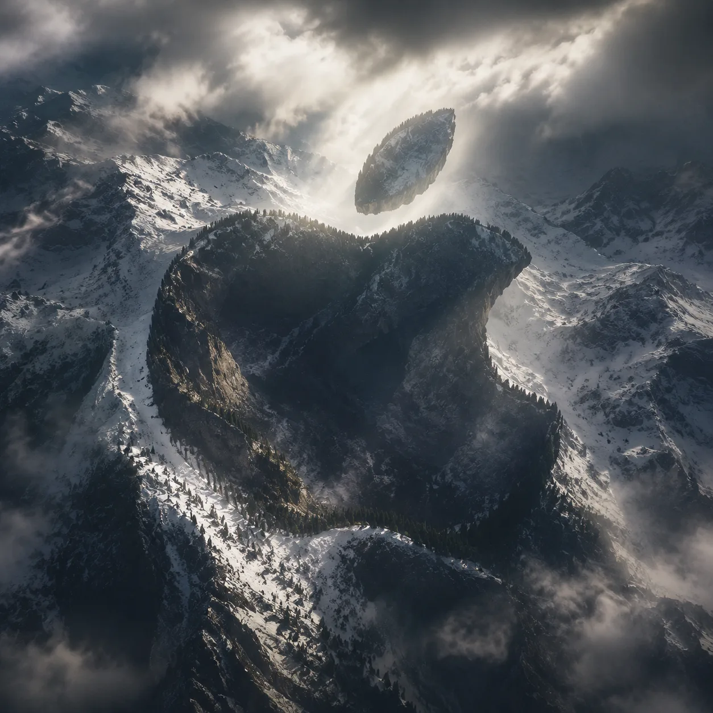

# Poster Design prompt #4

[← Back to the collection](../../README.md) · Category: [Poster Design](../../gallery/poster-design.md) · Model: `Vinano Studio` · ID: `vn-00004`

<a href="https://vinano.ai?utm_source=github&utm_medium=readme&utm_campaign=awesome-image-video-prompts-updating&utm_content=prompt-page-image"></a>

<sub>Preview generated with <a href="https://vinano.ai?utm_source=github&utm_medium=readme&utm_campaign=awesome-image-video-prompts-updating&utm_content=prompt-page-caption">vinano.ai</a></sub>

## Prompt

```text
<instruction>
 1. Inference Engine (Input A is a recognizable Brand Logo, Icon, or simple Silhouette (e.g., The Apple Logo, Nike Swoosh, Batman Symbol, A Heart).
Input B is a vast Natural Landscape (e.g., Snowy Mountains, Dense Jungle, Sand Dunes, Ocean Coastline).
Deconstruct the inputs to generate 3 Topographical Assets:
 The Negative Space (The Carving): How does the logo fit into the landscape?
 (e.g., The main body of the Apple logo is carved out of a snowy mountain peak).
 The Positive Space (The Island): Are there floating or detached elements of the logo?
 (e.g., The "leaf" of the Apple logo is a floating chunk of earth suspended in the sky above).
 The Texture (The Biome): What materials make up the shape?
 (e.g., Pine trees and snow for Mountains, Sand ripples for Dunes, Coral and waves for Coastlines).

 2. Container
Goal: "Subliminal Advertising" Landscape Photography.
 The Perspective: A wide, sweeping Aerial Drone Shot. The landscape stretches out vast and majestic, dominating the frame.
 The Atmosphere: Dramatic, moody weather. Heavy, swirling clouds, mist, or fog rolling through the valleys.

 3. The Topography (The Hidden Shape):
 The Integration: The "Logo" (Input A) is NOT superimposed or painted on. It is formed entirely by the physical geometry of the terrain.
 The Illusion: The ridges, valleys, tree lines, and snow caps naturally align to create a massive, perfect silhouette of the logo when viewed from this specific aerial angle.
 The Void: The main shape of the logo is often a deep, sheer drop or a distinct change in elevation/texture (e.g., a dark pine forest shaped like an apple cut into a white snowy mountain).
 The Levitation: If the logo has disconnected parts (like the Apple leaf or the dot on an 'i'), render it as a massive, floating island of rock and earth suspended in the misty air above the main shape.

 4. Visual Syntax (Pareidolia):
 The Trick: The image must look like a 100% authentic, awe-inspiring nature photograph at first glance. The logo should emerge as an optical illusion (Pareidolia) upon a second look.
 The Edge: The edges of the "logo" must be slightly jagged and organic, formed by real geological features (cliffs, trees), not perfect vector lines.

 5. Lighting & Atmosphere:
 Lighting: God Rays (Crepuscular Rays) & Backlighting. The sun is hidden behind the clouds or the floating landmass, blasting intense beams of light through the mist and defining the silhouette of the hidden shape.
 Contrast: High contrast between the dark valleys (forests/shadows) and the bright highlights (snow/sunlight).
 Vibe: Cinematic, majestic, and subtly surreal.

 Output: ONE image, 1:1 Aspect Ratio, National Geographic Aerial Photography, "Hidden Image" aesthetic, true-to-life photorealistic.
</instruction>

2. <system_role> you are an optical illusion artist and landscape photographer. </system_role> <illusion_topology> render a vast, true-to-life photorealistic {natural_environment}. however, the shadows, highlights, and physical layout of the landscape must form the exact facial contours and silhouette of {pop_culture_icon} when viewed from a distance. - dark zones (forming the eyes/hair/shadows): deep shadows cast by {dark_nature_elements}. - light zones (forming the skin/highlights): bright areas made of {light_nature_elements}. </illusion_topology> <visual_execution> the image must function flawlessly as two things at once: 1. up close: a beautiful, highly detailed photograph of a {natural_environment} during {weather_condition}. 2. zoomed out: a clear portrait of {pop_culture_icon}. ensure the blending is organic. do not use digital fade overlays. the rocks/trees themselves must form the face. </visual_execution>

Aim for an editorial, design-driven look with deliberate negative space.
```

## Try it on vinano.ai

1. Copy the prompt above.
2. Open **[vinano.ai](https://vinano.ai?utm_source=github&utm_medium=readme&utm_campaign=awesome-image-video-prompts-updating&utm_content=prompt-page-try)**, paste it into the image generator and pick a model.
3. Swap any placeholders (brand, product, city, person…) for your own details, then generate.

More prompts like this: [Poster Design gallery](../../gallery/poster-design.md) · [all categories](../../README.md#contents)
