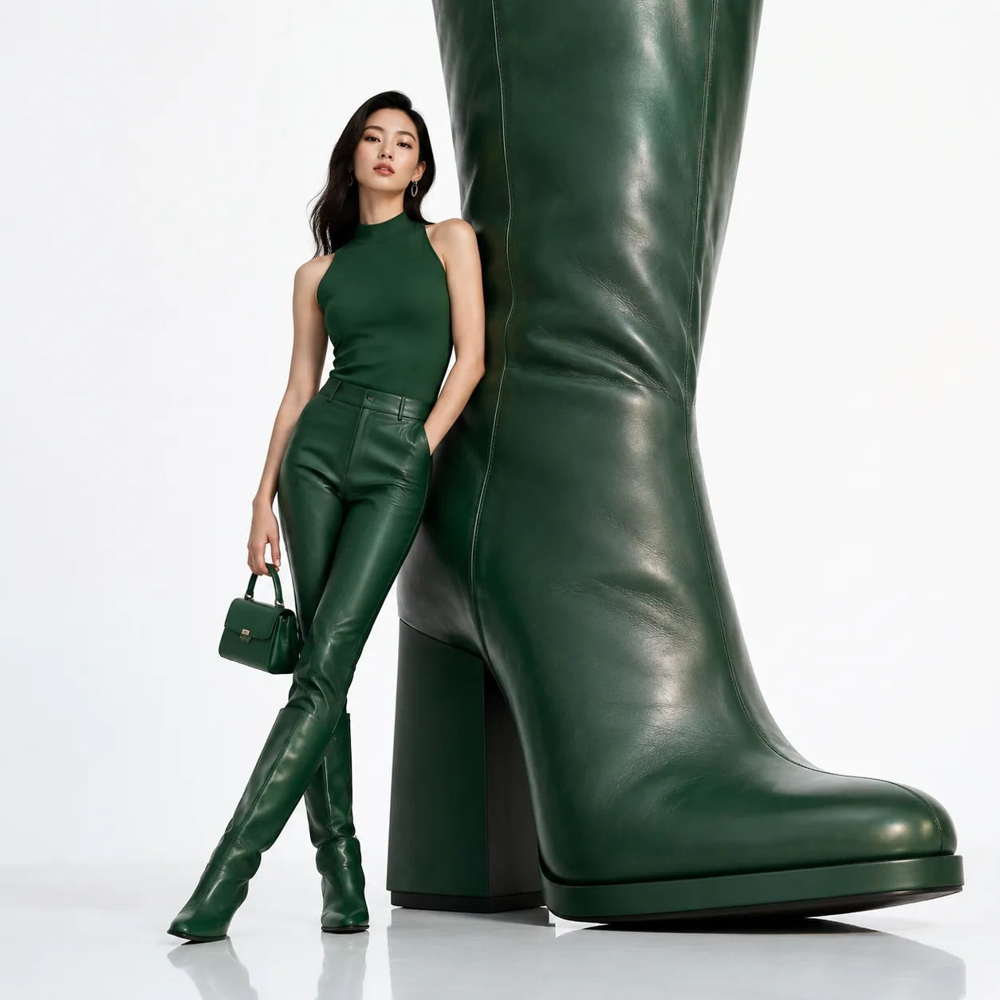

# Confident woman leaning casually against an oversized green leather

[← Back to the collection](../../README.md) · Category: [Poster Design](../../gallery/poster-design.md) · Model: `Vinano Studio` · ID: `vn-00332`

<a href="https://vinano.ai?utm_source=github&utm_medium=readme&utm_campaign=awesome-image-video-prompts-updating&utm_content=prompt-page-image"></a>

<sub>Preview generated with <a href="https://vinano.ai?utm_source=github&utm_medium=readme&utm_campaign=awesome-image-video-prompts-updating&utm_content=prompt-page-caption">vinano.ai</a></sub>

## Prompt

```text
{
 "style": "high-fashion editorial, refined minimalist surrealism",
 "subject": "a confident woman leaning casually against an oversized green leather boot sculpture",
 "pose": "relaxed yet powerful stance, body slightly angled, one arm holding a small handbag",
 "outfit": {
 "top": "emerald green fitted sleeveless top",
 "bottom": "matching green leather pants",
 "footwear": "knee-high green leather boots",
 "accessories": "small structured green handbag"
 },
 "composition": {
 "scale": "dramatic contrast between human figure and oversized object",
 "framing": "full body shot, centered subject negative space",
 "background": "pure white seamless studio backdrop",
 "floor": "glossy white reflective surface"
 },
 "lighting": {
 "type": "soft studio lighting",
 "mood": "clean, premium, editorial",
 "shadows": "subtle, natural, controlled"
 },
 "color_palette": "monochromatic green tones neutral white",
 "camera": {
 "angle": "eye-level",
 "lens": "85mm fashion lens",
 "depth_of_field": "sharp focus on subject, smooth background"
 },
 "vibe": "luxury fashion campaign, modern, confident, surreal elegance",
 "quality": "ultra-high resolution, crisp details, magazine-ready"
}

Emphasise material texture and natural light so the final frame feels tactile and premium.
```

## Try it on vinano.ai

1. Copy the prompt above.
2. Open **[vinano.ai](https://vinano.ai?utm_source=github&utm_medium=readme&utm_campaign=awesome-image-video-prompts-updating&utm_content=prompt-page-try)**, paste it into the image generator and pick a model.
3. Swap any placeholders (brand, product, city, person…) for your own details, then generate.

More prompts like this: [Poster Design gallery](../../gallery/poster-design.md) · [all categories](../../README.md#contents)
