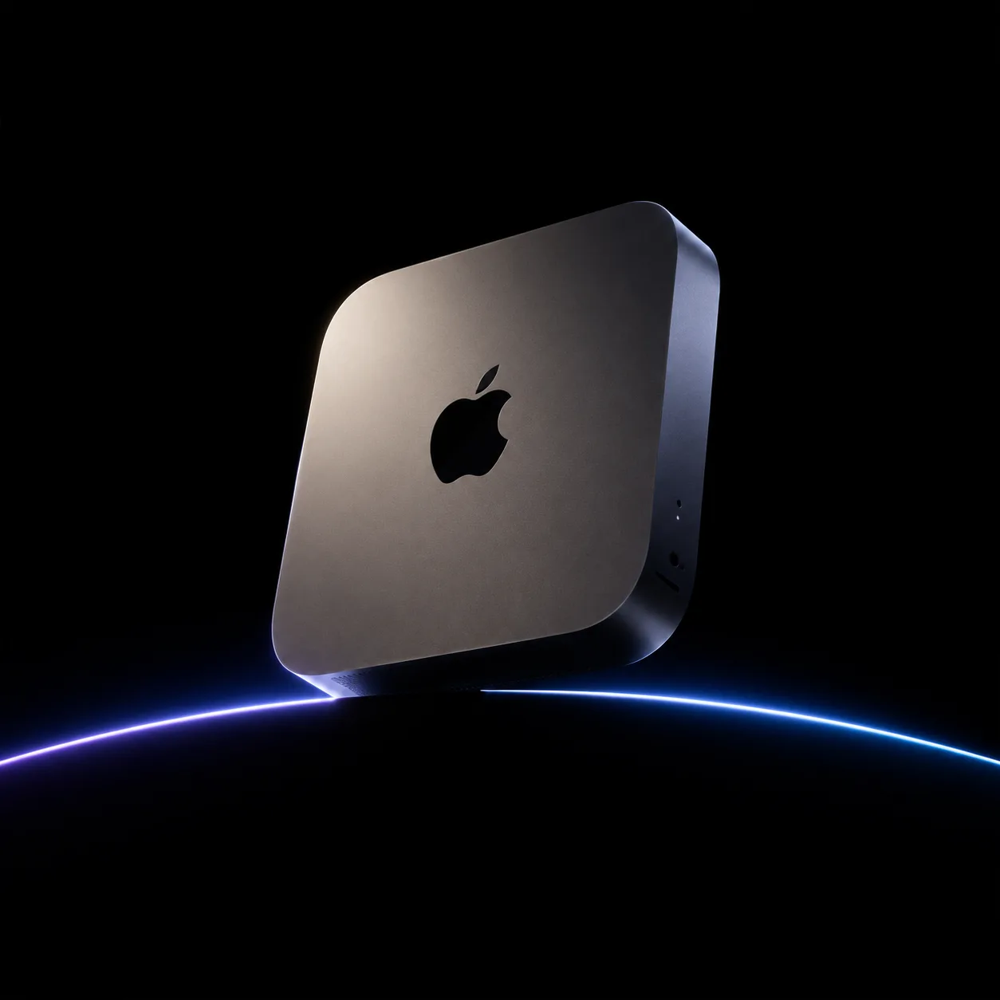

# Product from USER CUSTOMIZATION is perfectly centered

[← Back to the collection](../../README.md) · Category: [Poster Design](../../gallery/poster-design.md) · Model: `Vinano Studio` · ID: `vn-00375`

<a href="https://vinano.ai?utm_source=github&utm_medium=readme&utm_campaign=awesome-image-video-prompts-updating&utm_content=prompt-page-image"></a>

<sub>Preview generated with <a href="https://vinano.ai?utm_source=github&utm_medium=readme&utm_campaign=awesome-image-video-prompts-updating&utm_content=prompt-page-caption">vinano.ai</a></sub>

## Prompt

```text
{
 "project_name": "Premium_Dark_Horizon_Product_Reveal",
 "USER_CUSTOMIZATION": {
 "INSTRUCTIONS": "Replace 'current_setting' the product you want to render. The system will AUTOMATICALLY position it in a specific, fixed pose: tilted back its bottom-front tip touching the horizon edge.",
 "product": {
 "current_setting": "Mac Mini",
 "description": "The product will be rendered a dark, metallic, highly detailed finish."
 }
 },
 "settings": {
 "style": "Cinematic, high-contrast product photography in a dark environment. Ultra-sharp focus, rich color grading.",
 "aspect_ratio": "4:5"
 },
 "prompt_construction": {
 "MAIN_SUBJECT": {
 "subject": "The [product from USER_CUSTOMIZATION] is perfectly centered.",
 "appearance": "It has a premium, dark silver/chrome-like finish, looking solid and incredibly sharp. There is an ever-so-slight, subtle warmth mixed into the reflections on the metallic surfaces, giving it depth.",
 "pose_and_contact": "CRITICAL: The product is tilted back dramatically, away from the viewer towards the top of the frame. Its bottom-front tip or edge is PRECISELY touching the sharp center edge of the horizon arc. It must NOT float above the arc. This pose prominently displays the main surface (e.g., laptop lid logo, phone screen/back, watch face)."
 },
 "HORIZON_ARC": {
 "description": "A single, clean, massive, dark horizon line arcs across the entire width of the screen from left to right. It is NOT a complete sphere, glowing ball, or circle, but the very edge of a dark planet-like surface.",
 "light_profile": "The edge itself is defined by a thin, sharp, soft-glow blue light. The light is thinnest and sharpest (purplish-blue) in the bottom-left, widening slightly to a brighter, soft white-blue rim on the right before fading. It must NOT reveal the spherical form of the surface below; the area below the arc must remain pitch black.",
 "reflection_effect": "CRITICAL: There are ABSOLUTELY NO reflections of the product on the horizon surface. The surface is dark and matte."
 },
 "LIGHTING_AND_BACKGROUND": {
 "background": "Pure, absolute black negative space. There are NO visible light rays, gradients, starfields, halos, or any other light shapes above or around the product.",
 "key_lighting": "A strong key light from the TOP-LEFT sculpts the product, emphasizing its form and the logo/main feature. It does NOT create visible rays.",
 "rim_lighting": "A distinct rim light from the BACK-LEFT separates the product from the dark background.",
 "fill_lighting": "A soft fill light from the BOTTOM-RIGHT opens up the shadows slightly.",
 "color_cast": "All lighting is dominated by deep, rich blues, consistent the horizon arc."
 },
 "COMPOSITION_AND_FRAMING": {
 "framing": "The product is perfectly centered. The camera distance is fixed, ensuring the product is large and dominant but NEVER cut off.",
 "perspective": "A sharp, eye-level perspective relative to the product's center, looking slightly down towards the horizon."
 }
 },
 "NEGATIVE_CONSTRAINTS": ["visible light rays",
 "glow or light source in the top left corner",
 "product floating above the arc",
 "product not touching the arc edge",
 "product lying flat",
 "visible sphere or glowing orb form below the arc",
 "halos or circular lights above the product",
 "harsh light glows",
 "reflections of the product on the horizon",
 "background other than pure black",
 "product cut off by frame edge",
 "upside-down or downward curve",
 "squiggly arc"],
 "FULL_PROMPT_STRING": "A cinematic product photograph of [product from USER_CUSTOMIZATION] a dark, sharp, silver/chrome finish and subtle warmth. The product is perfectly centered, tilted back dramatically its bottom-front tip precisely touching the sharp center edge of a single, massive, dark horizon arc that spans the frame. This arc is a thin, sharp, soft-glow blue light, purplish-blue in the bottom-left, widening to a soft white-blue rim on the right, before fading to pitch black. The area below the arc is absolute black. There are NO reflections on the horizon. The background is pure, light-ray-free, halo-free black negative space. There is NO glow or light source in the top left corner. Key light from the top-left, rim light from the back-left, and soft fill from the bottom-right create a dramatic, volumetric, blue-dominated lighting scheme. The product is never cut off. 8k resolution, highly detailed."
}

Emphasise material texture and natural light so the final frame feels tactile and premium.
```

## Try it on vinano.ai

1. Copy the prompt above.
2. Open **[vinano.ai](https://vinano.ai?utm_source=github&utm_medium=readme&utm_campaign=awesome-image-video-prompts-updating&utm_content=prompt-page-try)**, paste it into the image generator and pick a model.
3. Swap any placeholders (brand, product, city, person…) for your own details, then generate.

More prompts like this: [Poster Design gallery](../../gallery/poster-design.md) · [all categories](../../README.md#contents)
