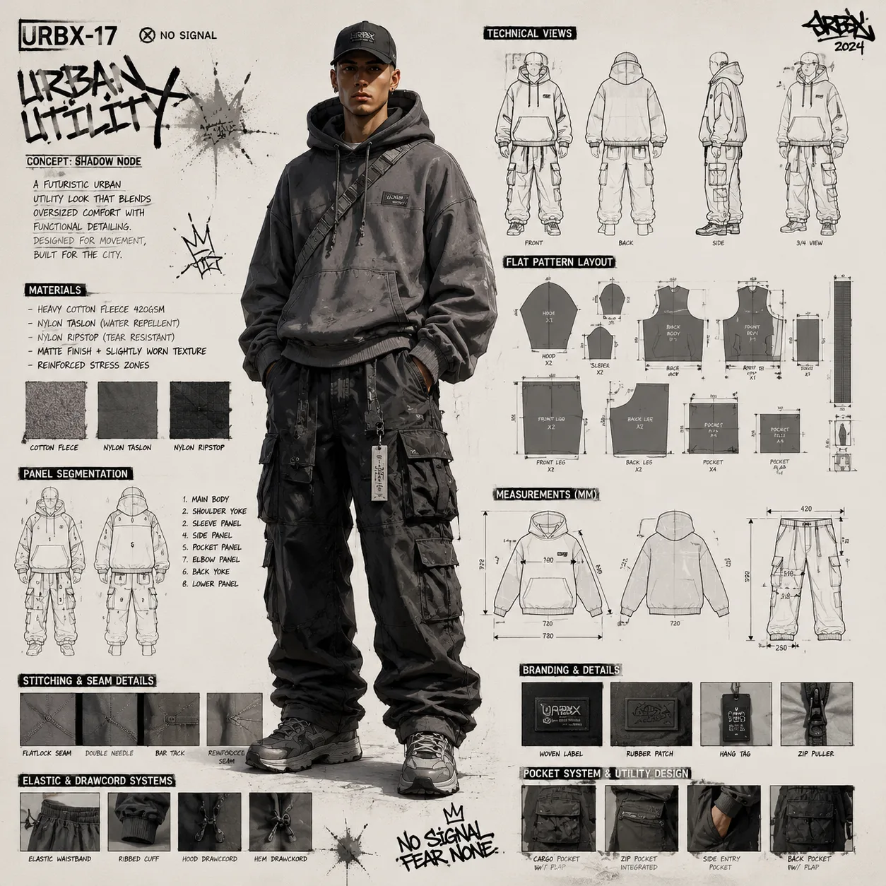

# Attached image, create a professional industrial fashion design illustration

[← Back to the collection](../../README.md) · Category: [Poster Design](../../gallery/poster-design.md) · Model: `Vinano Studio` · ID: `vn-00396`

<a href="https://vinano.ai?utm_source=github&utm_medium=readme&utm_campaign=awesome-image-video-prompts-updating&utm_content=prompt-page-image"></a>

<sub>Preview generated with <a href="https://vinano.ai?utm_source=github&utm_medium=readme&utm_campaign=awesome-image-video-prompts-updating&utm_content=prompt-page-caption">vinano.ai</a></sub>

## Prompt

```text
the attached image, create a professional industrial fashion design illustration sheet for a high-end streetwear outfit.
A centered heroic full-body 3D render of a modern urban look (oversized hoodie, cargo pants, sneakers), realistic fabric physics, detailed stitching, and layered textiles. Soft studio lighting subtle shadows and premium editorial finish.
Surround technical views:
Front, back, side, 3/4 perspective
Flat lay pattern layout
Include sketches:
Panel segmentation (oversized cuts)
Stitching and seam details
Elastic waistband, cuffs, drawstrings
Measurement arrows in millimeters
Materials (handwritten notes):
Heavy cotton fleece, nylon, ripstop
Matte + slightly worn textures
Reinforced stress zones
Extras:
Street branding placement (logos, tags, patches)
Pocket systems and utility design
Style: Clean sketchbook + graffiti undertone, realistic + pencil hybrid, ultra-detailed.

Keep edges clean and the overall composition balanced for a polished, gallery-ready result.
```

## Try it on vinano.ai

1. Copy the prompt above.
2. Open **[vinano.ai](https://vinano.ai?utm_source=github&utm_medium=readme&utm_campaign=awesome-image-video-prompts-updating&utm_content=prompt-page-try)**, paste it into the image generator and pick a model.
3. Swap any placeholders (brand, product, city, person…) for your own details, then generate.

More prompts like this: [Poster Design gallery](../../gallery/poster-design.md) · [all categories](../../README.md#contents)
