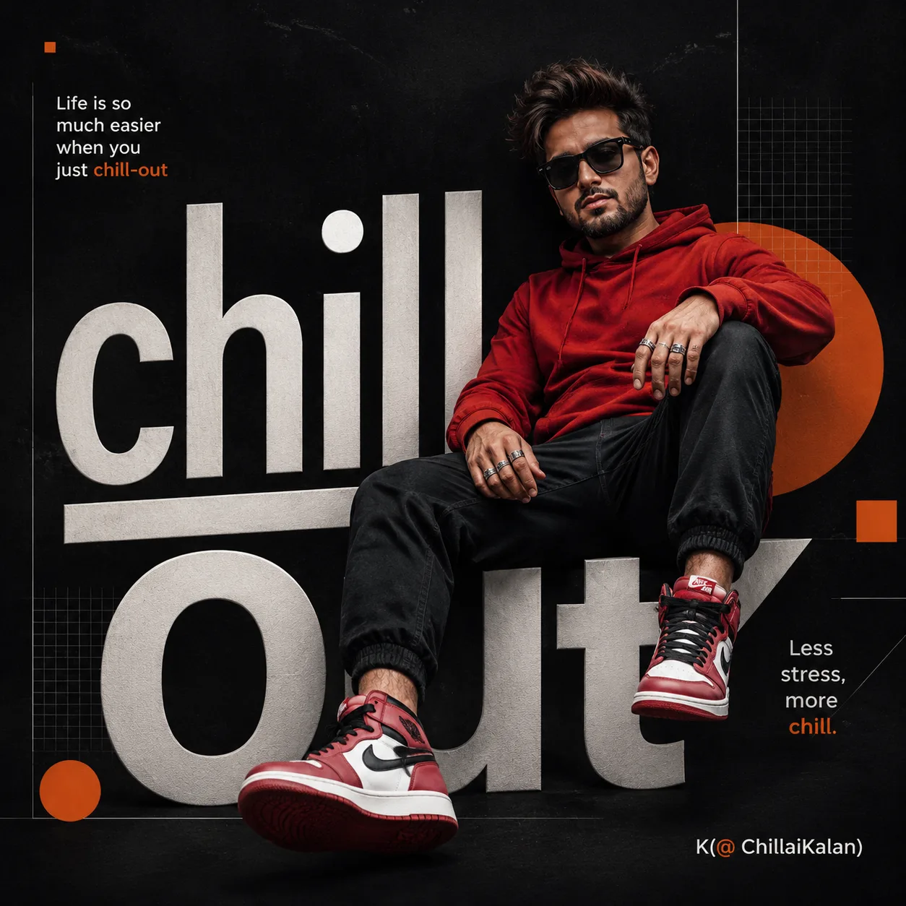

# 8K UHD cinematic poster portrait of a man inspired

[← Back to the collection](../../README.md) · Category: [Poster Design](../../gallery/poster-design.md) · Model: `Vinano Studio` · ID: `vn-00477`

<a href="https://vinano.ai?utm_source=github&utm_medium=readme&utm_campaign=awesome-image-video-prompts-updating&utm_content=prompt-page-image"></a>

<sub>Preview generated with <a href="https://vinano.ai?utm_source=github&utm_medium=readme&utm_campaign=awesome-image-video-prompts-updating&utm_content=prompt-page-caption">vinano.ai</a></sub>

## Prompt

```text
Create a hyper-realistic 8K UHD cinematic poster portrait of a man inspired by the reference image, a similar hairstyle, facial structure, and body build while maintaining a natural realistic look. Shot as if captured on a 35mm lens, f/1.8, sharp focus, creamy bokeh, cinematic color grading, and detailed DSLR skin texture.

Design a modern graphic poster titled “Chill-out.” The man wears a red hoodie, black cuffed joggers, red and white Air Jordan high-top sneakers, dark sunglasses, and silver rings. He sits in a relaxed reclined pose leaning against oversized typography, one leg bent and the other slightly extended toward the viewer. His body angles right while his face turns toward the camera in a confident three-quarter view.

Background is matte textured black. Large bold white sans-serif text “chill” and “out” forms a bench-like structure, “chill” underlined. Add orange circles, squares, thin white grid lines, and phrases: “Life is so much easier when you just chill-out” and “Less stress, more chill.”

Bottom-right watermark: K(@ ChillaiKalan),

Emphasise material texture and natural light so the final frame feels tactile and premium.
```

## Try it on vinano.ai

1. Copy the prompt above.
2. Open **[vinano.ai](https://vinano.ai?utm_source=github&utm_medium=readme&utm_campaign=awesome-image-video-prompts-updating&utm_content=prompt-page-try)**, paste it into the image generator and pick a model.
3. Swap any placeholders (brand, product, city, person…) for your own details, then generate.

More prompts like this: [Poster Design gallery](../../gallery/poster-design.md) · [all categories](../../README.md#contents)
