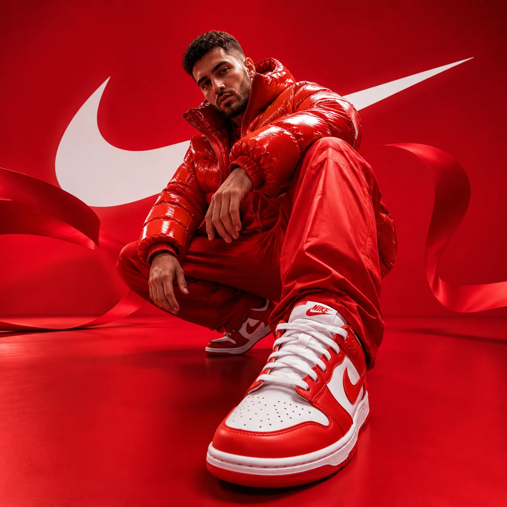

# MAN LIGHT-MEDIUM SKIN, SHORT DARK CURLY HAIR A FADE

[← Back to the collection](../../README.md) · Category: [Poster Design](../../gallery/poster-design.md) · Model: `Vinano Studio` · ID: `vn-00504`

<a href="https://vinano.ai?utm_source=github&utm_medium=readme&utm_campaign=awesome-image-video-prompts-updating&utm_content=prompt-page-image"></a>

<sub>Preview generated with <a href="https://vinano.ai?utm_source=github&utm_medium=readme&utm_campaign=awesome-image-video-prompts-updating&utm_content=prompt-page-caption">vinano.ai</a></sub>

## Prompt

```text
A MAN LIGHT-MEDIUM SKIN, SHORT DARK CURLY HAIR A FADE HAIRCUT,BROWN EYES,
AND A WELL-GROOMED SHORT BEARD, WEARING A GLOSSY OVERSIZED RED PUFFER JACKET AND
LOOSE RED PANTS WHITE AND RED NIKE SNEAKERS, CROUCHING LOW ONE KNEE UP AND
ONE LEG FORWARD, LEFT ARM RESTING CASUALLY OVER THE RAISED KNEE AND RIGHT HAND
RELAXED NEAR THE OTHER LEG, BODY ANGLED SLIGHTLY TO THE SIDE WHILE HEAD TILTS
FORWARD LOOKING DIRECTLY AT THE CAMERA A CONFIDENT EXPRESSION, ULTRA WIDE-ANGLE
LOW PERSPECTIVE SHOT EMPHASIZING THE FRONT SNEAKER APPEARING LARGE AND DOMINANT IN
THE FOREGROUND, SET IN A FULLY RED ENVIRONMENT SMOOTH FLOOR AND BACKDROP
FEATURING LARGE WHITE NIKE SWOOSH LOGOS BEHIND AND FLOWING RIBBON-LIKE RED SHAPES
AROUND, HYPER-REALISTIC PHOTOGRAPHY, EXTREMELY SHARP DETAILS ON FABRIC SHINE AND
SNEAKER TEXTURE, DRAMATIC STUDIO LIGHTING STRONG HIGHLIGHTS AND SOFT SHADOWS
SATURATED MONOCHROMATIC RED COLOR PALETTE WHITE ACCENTS, MODERN STREETWEAR
CAMPAIGN STYLE, NO BLUR, NO DISTORTION, NO EXTRA LIMBS, NO ARTIFACTS

Aim for an editorial, design-driven look with deliberate negative space.
```

## Try it on vinano.ai

1. Copy the prompt above.
2. Open **[vinano.ai](https://vinano.ai?utm_source=github&utm_medium=readme&utm_campaign=awesome-image-video-prompts-updating&utm_content=prompt-page-try)**, paste it into the image generator and pick a model.
3. Swap any placeholders (brand, product, city, person…) for your own details, then generate.

More prompts like this: [Poster Design gallery](../../gallery/poster-design.md) · [all categories](../../README.md#contents)
