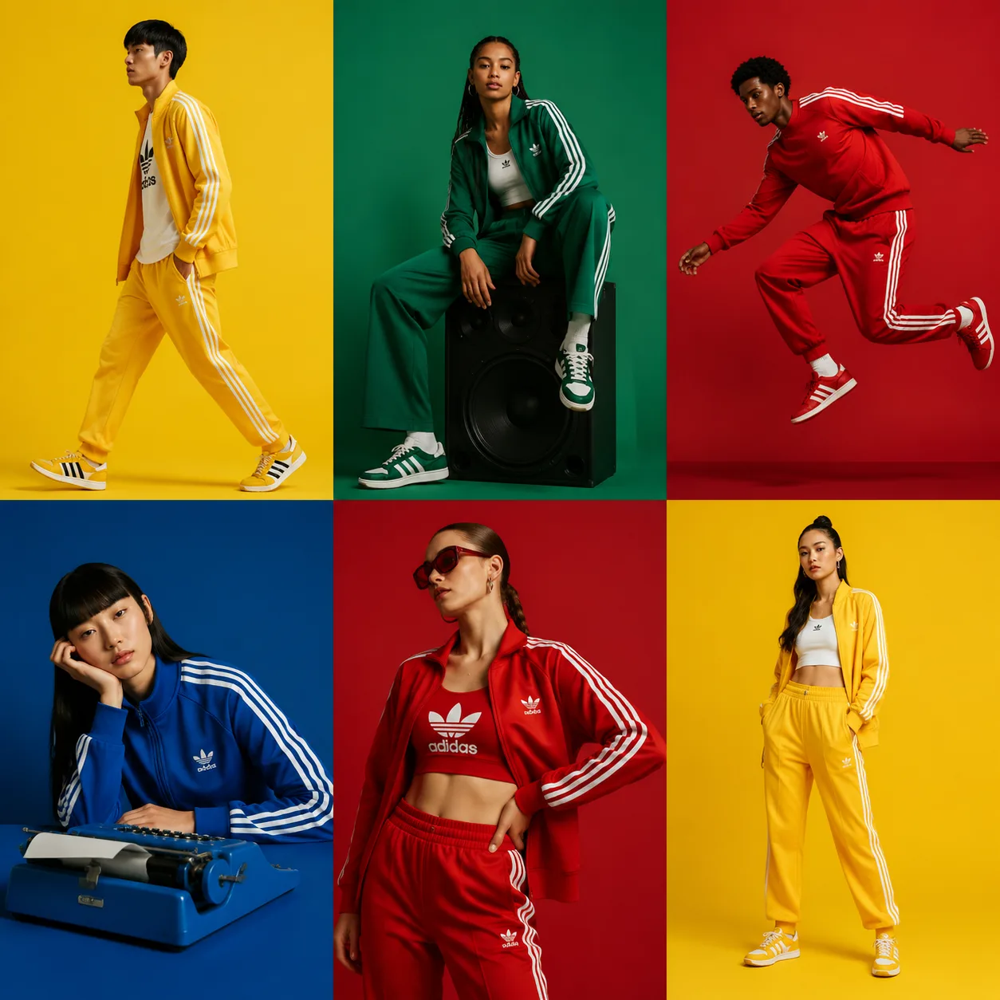

# Premium-quality, split-screen fashion editorial advertisement featuring multiple panels

[← Back to the collection](../../README.md) · Category: [Poster Design](../../gallery/poster-design.md) · Model: `Vinano Studio` · ID: `vn-00548`

<a href="https://vinano.ai?utm_source=github&utm_medium=readme&utm_campaign=awesome-image-video-prompts-updating&utm_content=prompt-page-image"></a>

<sub>Preview generated with <a href="https://vinano.ai?utm_source=github&utm_medium=readme&utm_campaign=awesome-image-video-prompts-updating&utm_content=prompt-page-caption">vinano.ai</a></sub>

## Prompt

```text
A premium-quality, split-screen fashion editorial advertisement featuring multiple panels of different colors (yellow, green, deep red, blue). The image shows models wearing Adidas-style tracksuits and casual sportswear in corresponding colors that match their background panel. One male model in yellow is walking, one female model in green is sitting on a speaker, one male model in red is jumping, one female model in blue is sitting by a blue typewriter, one female model in red is posing in a red panel, and one female model in yellow is standing. Clean studio lighting, vibrant solid-color backgrounds, professional fashion photography, refined minimalist aesthetic, sharp focus Maintain consistent colour harmony and crisp focus across the whole frame.
```

## Try it on vinano.ai

1. Copy the prompt above.
2. Open **[vinano.ai](https://vinano.ai?utm_source=github&utm_medium=readme&utm_campaign=awesome-image-video-prompts-updating&utm_content=prompt-page-try)**, paste it into the image generator and pick a model.
3. Swap any placeholders (brand, product, city, person…) for your own details, then generate.

More prompts like this: [Poster Design gallery](../../gallery/poster-design.md) · [all categories](../../README.md#contents)
