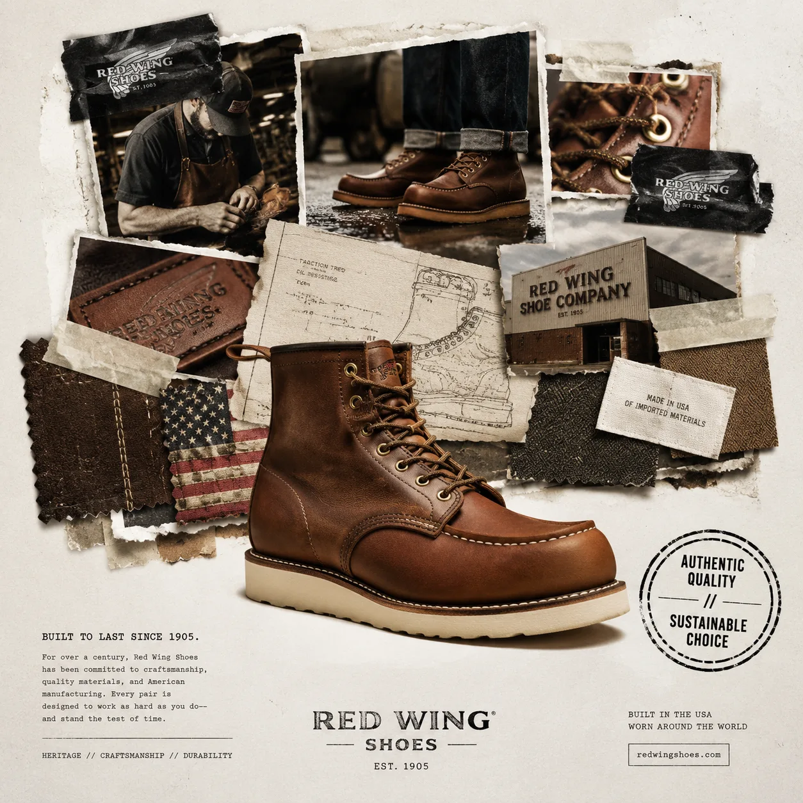

# Poster Design prompt #677

[← Back to the collection](../../README.md) · Category: [Poster Design](../../gallery/poster-design.md) · Model: `Vinano Studio` · ID: `vn-00677`

<a href="https://vinano.ai?utm_source=github&utm_medium=readme&utm_campaign=awesome-image-video-prompts-updating&utm_content=prompt-page-image"></a>

<sub>Preview generated with <a href="https://vinano.ai?utm_source=github&utm_medium=readme&utm_campaign=awesome-image-video-prompts-updating&utm_content=prompt-page-caption">vinano.ai</a></sub>

## Prompt

```text
[BRAND NAME]

[PRODUCT TYPE] (Clothing / Food / Automotive / Tech).

Goal: Generate a professional "scrapbook" style collage poster for [BRAND NAME] centered around a [PRODUCT TYPE].

1. HERO PRODUCT (BOTTOM FOCUS)

- Object: A high-definition, realistic 3D render of a [PRODUCT TYPE] by [BRAND NAME] at the bottom center.

- Placement: Slightly angled to show depth, soft realistic contact shadows on a plain off-white floor.

2. THE MULTI-LAYERED COLLAGE STACK

- Photos: A vertical stack of overlapping photos RAGGED, TORN paper edges rising above the product.

- Content: Photos should show [PRODUCT TYPE] in use, lifestyle shots related to [BRAND NAME], and close-ups of specific details.

- Materials: Physical swatches of textures related to [PRODUCT TYPE] (e.g., leather/fabric for clothing, metal/carbon for cars, organic ingredients for food). Include visible raw edges and stitching.

- Fasteners: Use strips of semi-transparent masking tape and black duct tape the "[BRAND NAME]" logo printed in white to "hold" the pieces together.

3. GRAPHIC OVERLAYS & STAMPS

- Stamp: A black, distressed ink stamp or seal near the hero product text: "AUTHENTIC QUALITY // SUSTAINABLE CHOICE".

- Typography: Small, clean sans-serif and typewriter-style text blocks describing the heritage of [BRAND NAME] placed at the bottom.

- Logo: The primary "[BRAND NAME]" logo centered at the very bottom in a refined minimalist font.

4. STYLE & ATMOSPHERE

- Aesthetic: Industrial DIY, workshop moodboard, high-end editorial collage.

- Lighting: Bright, studio high-key lighting soft, multi-layered shadows between the paper scraps and textures.

- Quality: 8K resolution, macro detail on paper grain, fabric fibers, and tape adhesive.

Render with rich micro-detail while keeping the layout uncluttered and intentional.
```

## Try it on vinano.ai

1. Copy the prompt above.
2. Open **[vinano.ai](https://vinano.ai?utm_source=github&utm_medium=readme&utm_campaign=awesome-image-video-prompts-updating&utm_content=prompt-page-try)**, paste it into the image generator and pick a model.
3. Swap any placeholders (brand, product, city, person…) for your own details, then generate.

More prompts like this: [Poster Design gallery](../../gallery/poster-design.md) · [all categories](../../README.md#contents)
