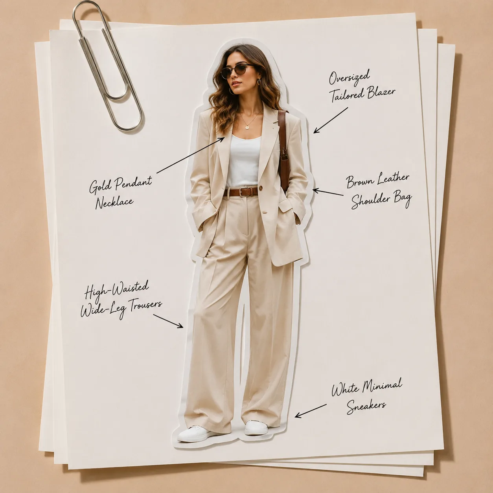

# Poster Design prompt #684

[← Back to the collection](../../README.md) · Category: [Poster Design](../../gallery/poster-design.md) · Model: `Vinano Studio` · ID: `vn-00684`

<a href="https://vinano.ai?utm_source=github&utm_medium=readme&utm_campaign=awesome-image-video-prompts-updating&utm_content=prompt-page-image"></a>

<sub>Preview generated with <a href="https://vinano.ai?utm_source=github&utm_medium=readme&utm_campaign=awesome-image-video-prompts-updating&utm_content=prompt-page-caption">vinano.ai</a></sub>

## Prompt

```text
Masterpiece, best quality, high resolution, 8k, (true-to-life photorealistic:1.4), (Vibrant natural colors:1.2), (Full body shot:1.6), refined minimalist fashion scrapbook page.
Subject: A full body fashion photo of [Character Description] standing in a [Pose]. The subject is wearing [Detailed Outfit]. The subject is a sharp, high-detail photographic cutout sticker borders. The sticker has a die-cut white paper edge visible paper-fiber texture on the cut-line. This white border has a subtle 3D thickness (beveled edge) that catches the light, creating a realistic micro-shadow.

Composition: Professional top-down flat-lay view. A thin stack of 3-4 clean-cut premium white paper sheets (smooth edges) placed on a seamless Soft [Color] background. Medium camera distance for a clear full-body view. A single, (prominent oversized silver metal trombone paperclip:1.5) at the top left corner, showing realistic metallic reflections and micro-scratches. 5 delicate hand-drawn black ink arrows pointing to specific fashion details:

"[Feature 1]" (pointing to [Detail]).
"[Feature 2]" (pointing to [Detail]).
"[Feature 3]" (pointing to [Detail]).
"[Feature 4]" (pointing to [Detail]).
All annotations are in refined, elegant handwritten cursive. Ray-traced ambient occlusion around the sticker's white border to emphasize physical elevation and depth. Ray-traced soft shadows between the paper layers. High-end editorial studio lighting. Visible tactile paper micro-texture throughout the character's edges, clean and modern high-fashion aesthetic. No grayscale, full color photography, no illustration.

Preserve realistic proportions and depth for a confident, professional finish.
```

## Try it on vinano.ai

1. Copy the prompt above.
2. Open **[vinano.ai](https://vinano.ai?utm_source=github&utm_medium=readme&utm_campaign=awesome-image-video-prompts-updating&utm_content=prompt-page-try)**, paste it into the image generator and pick a model.
3. Swap any placeholders (brand, product, city, person…) for your own details, then generate.

More prompts like this: [Poster Design gallery](../../gallery/poster-design.md) · [all categories](../../README.md#contents)
