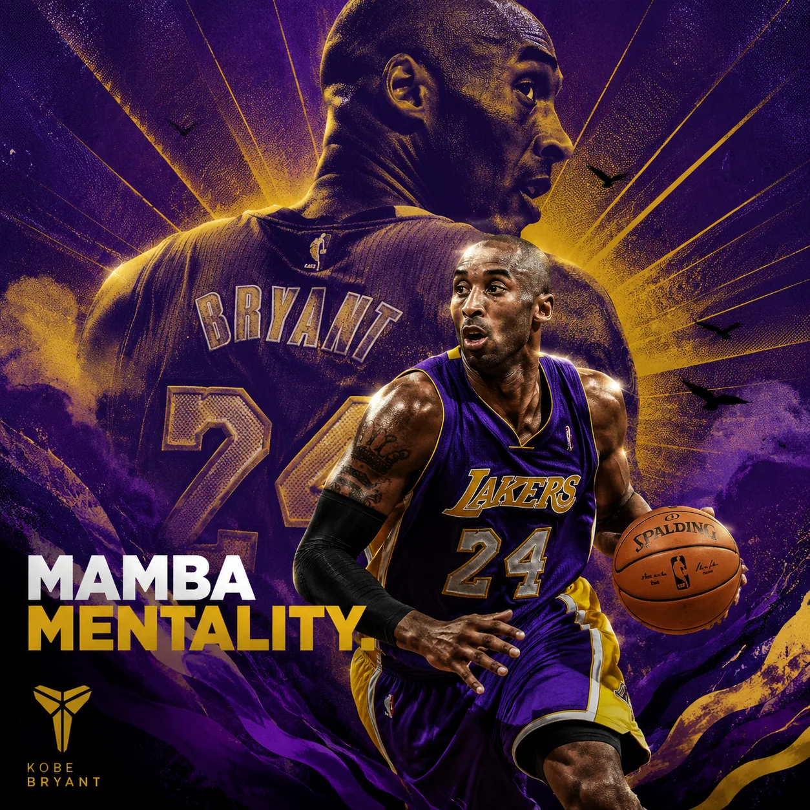

# - Layered Effect

[← Back to the collection](../../README.md) · Category: [Poster Design](../../gallery/poster-design.md) · Model: `Vinano Studio` · ID: `vn-00754`

<a href="https://vinano.ai?utm_source=github&utm_medium=readme&utm_campaign=awesome-image-video-prompts-updating&utm_content=prompt-page-image"></a>

<sub>Preview generated with <a href="https://vinano.ai?utm_source=github&utm_medium=readme&utm_campaign=awesome-image-video-prompts-updating&utm_content=prompt-page-caption">vinano.ai</a></sub>

## Prompt

```text
[PERSONE]. Act as a Senior Art Director.

PHASE 1: PHOTOGRAPHIC COMPOSITION.

- Layered Effect: Double exposure photographic collage. High-definition action shot in the foreground; massive monumental silhouette in the background.

- Overlap: The subject must seamlessly integrate the background graphics.

PHASE 2: CONTEXTUAL VIBE SIMULATION.

- Identity Analysis: Autonomously identify the core industry of [PERSONE] (Sport, Music, Cinema, or Business).

- Pose & Props:

PHASE 3: DYNAMIC COLOR & BRAND SIMULATION (VARIABLE COLORS).

- Primary Color (Atmosphere): Identify the MOST ICONIC color associated [PERSONE] or their team/brand. Use this for the background, halftone textures, and smoke.

- Accent Color (Impact): Identify a secondary high-contrast VIBRANT hue (e.g., neon, gold, or electric white). Use this for the "Radial Burst" rays.

- Visual Texture: Apply heavy film grain and halftone dots (screen printing effect) to the shadows of the high-res photos.

PHASE 4: GRAPHIC ACCENTS.

- Geometry: Bold radial rays bursting from the center. Fluid, wave-like organic shapes at the base.

- Birds: refined minimalist black bird silhouettes for scale and depth.

PHASE 5: BRANDING & TEXT.

- Tagline: Generate a powerful, one-word or two-word slogan tailored to [PERSONE]'s legacy.

- Logo: Place a refined minimalist, industry-appropriate logo in the bottom corner.

- Typography: Bold, high-impact Sans-Serif.

TECHNICAL FINISH:

- Quality: 8k resolution, authentic commercial photography style (NOT an illustration).

- Lighting: Extreme studio rim-lighting (contour highlights) to separate the photographic subjects from the graphic layers.

Keep edges clean and the overall composition balanced for a polished, gallery-ready result.
```

## Try it on vinano.ai

1. Copy the prompt above.
2. Open **[vinano.ai](https://vinano.ai?utm_source=github&utm_medium=readme&utm_campaign=awesome-image-video-prompts-updating&utm_content=prompt-page-try)**, paste it into the image generator and pick a model.
3. Swap any placeholders (brand, product, city, person…) for your own details, then generate.

More prompts like this: [Poster Design gallery](../../gallery/poster-design.md) · [all categories](../../README.md#contents)
