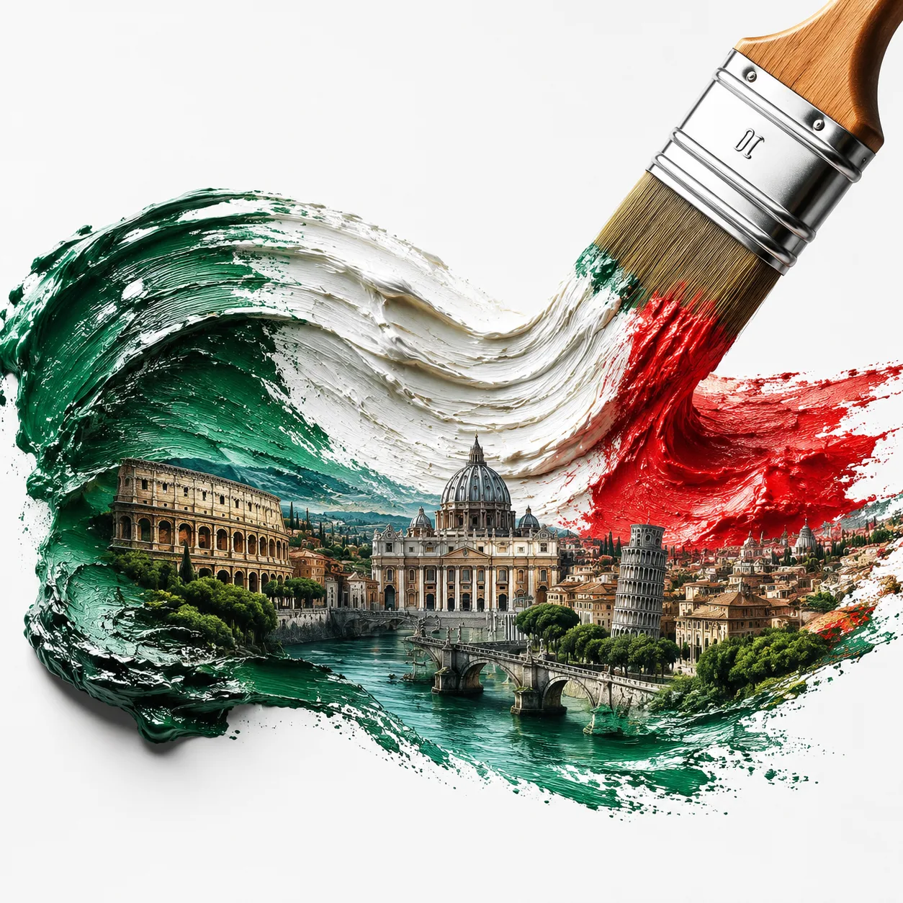

# Macro shot of a paintbrush creating a thick textured

[← Back to the collection](../../README.md) · Category: [Poster Design](../../gallery/poster-design.md) · Model: `Vinano Studio` · ID: `vn-00783`

<a href="https://vinano.ai?utm_source=github&utm_medium=readme&utm_campaign=awesome-image-video-prompts-updating&utm_content=prompt-page-image"></a>

<sub>Preview generated with <a href="https://vinano.ai?utm_source=github&utm_medium=readme&utm_campaign=awesome-image-video-prompts-updating&utm_content=prompt-page-caption">vinano.ai</a></sub>

## Prompt

```text
A hyper-realistic macro shot of a paintbrush creating a thick textured paint stroke on a clean white background. The paint forms the shape and colors of the [COUNTRY FLAG], flowing dynamically like a wave. Inside the paint stroke, a highly detailed miniature cityscape of [COUNTRY NAME] emerges, including iconic landmarks such as [LANDMARK 1], [LANDMARK 2], [LANDMARK 3]. The paint has visible brush textures, glossy acrylic finish, rich vibrant colors. Maintain consistent colour harmony and crisp focus across the whole frame.
```

## Try it on vinano.ai

1. Copy the prompt above.
2. Open **[vinano.ai](https://vinano.ai?utm_source=github&utm_medium=readme&utm_campaign=awesome-image-video-prompts-updating&utm_content=prompt-page-try)**, paste it into the image generator and pick a model.
3. Swap any placeholders (brand, product, city, person…) for your own details, then generate.

More prompts like this: [Poster Design gallery](../../gallery/poster-design.md) · [all categories](../../README.md#contents)
