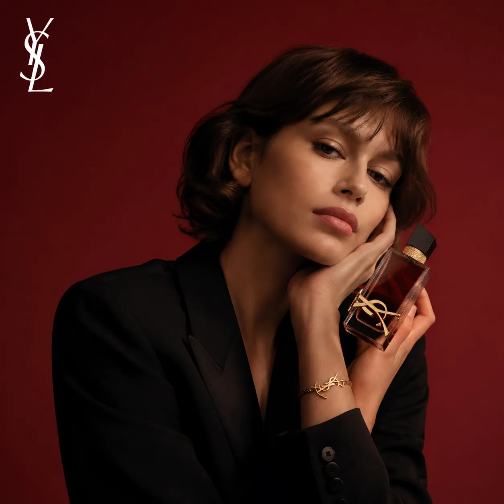

# Upload luxury product photo BRAND NAME

[← Back to the collection](../../README.md) · Category: [Poster Design](../../gallery/poster-design.md) · Model: `Vinano Studio` · ID: `vn-00805`

<a href="https://vinano.ai?utm_source=github&utm_medium=readme&utm_campaign=awesome-image-video-prompts-updating&utm_content=prompt-page-image"></a>

<sub>Preview generated with <a href="https://vinano.ai?utm_source=github&utm_medium=readme&utm_campaign=awesome-image-video-prompts-updating&utm_content=prompt-page-caption">vinano.ai</a></sub>

## Prompt

```text
[upload luxury product photo]
BRAND NAME: [Put the brand name here]

Create ONE luxury editorial poster. Keep the product EXACT and unchanged. Use the BRAND NAME to infer identity and place the REAL official logo (correct proportions) in the most brand-appropriate position subtle print texture. Add a perfectly matched attractive model wearing the product naturally. Rich deep colors, HDR, premium studio lighting, clean background, strong negative space, ultra-sharp 8K. No extra text, no watermark.

Emphasise material texture and natural light so the final frame feels tactile and premium.
```

## Try it on vinano.ai

1. Copy the prompt above.
2. Open **[vinano.ai](https://vinano.ai?utm_source=github&utm_medium=readme&utm_campaign=awesome-image-video-prompts-updating&utm_content=prompt-page-try)**, paste it into the image generator and pick a model.
3. Swap any placeholders (brand, product, city, person…) for your own details, then generate.

More prompts like this: [Poster Design gallery](../../gallery/poster-design.md) · [all categories](../../README.md#contents)
