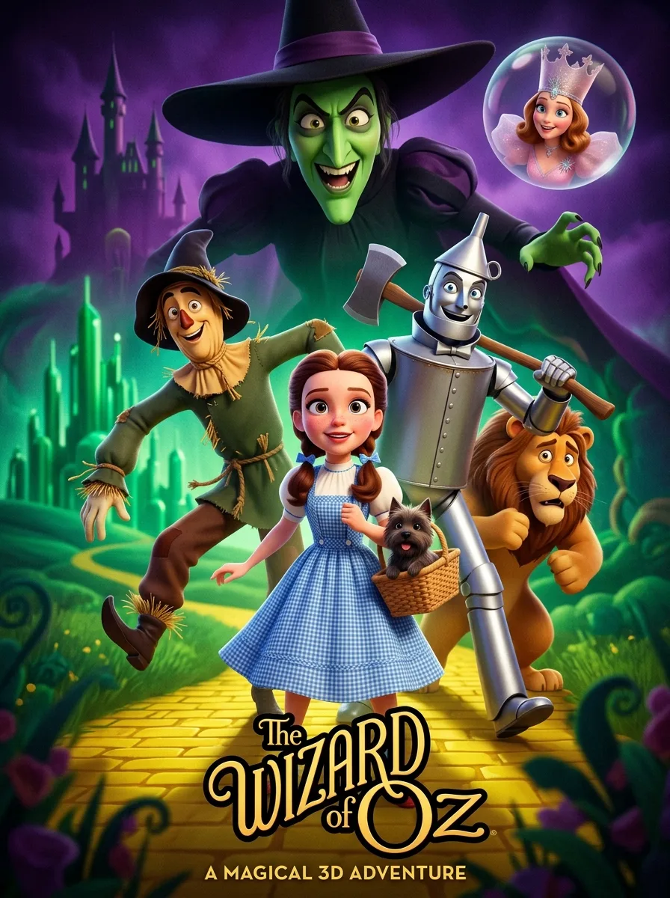

# Pixar 3D CGI animated movie poster style, ensemble cast

[← Back to the collection](../../README.md) · Category: [Poster Design](../../gallery/poster-design.md) · Model: `Vinano Image Pro` · ID: `vn-00806`

<a href="https://vinano.ai?utm_source=github&utm_medium=readme&utm_campaign=awesome-image-video-prompts-updating&utm_content=prompt-page-image"></a>

<sub>Preview generated with <a href="https://vinano.ai?utm_source=github&utm_medium=readme&utm_campaign=awesome-image-video-prompts-updating&utm_content=prompt-page-caption">vinano.ai</a></sub>

## Prompt

```text
Pixar 3D CGI animated movie poster style, ensemble cast featuring the most iconic and recognizable characters from [MOVIE/SHOW], all rendered as Pixar-style 3D animated characters exaggerated expressive faces, smooth stylized skin, big eyes, chunky proportions. Characters automatically selected as the most famous heroes and villains from [MOVIE/SHOW]. Dramatic layered composition: central hero front and center, others fanned behind in dynamic action poses. Background color automatically chosen to match the iconic tone and palette of [MOVIE/SHOW]. Bold title text at bottom: [MOVIE/SHOW] in the original film's iconic font style. filmic, cinematic lighting, rim light on characters, deep shadows. 3:4 vertical aspect ratio. High detail, polished Pixar feature film aesthetic. Aim for an editorial, design-driven look with deliberate negative space.
```

## Try it on vinano.ai

1. Copy the prompt above.
2. Open **[vinano.ai](https://vinano.ai?utm_source=github&utm_medium=readme&utm_campaign=awesome-image-video-prompts-updating&utm_content=prompt-page-try)**, paste it into the image generator and pick a model.
3. Swap any placeholders (brand, product, city, person…) for your own details, then generate.

More prompts like this: [Poster Design gallery](../../gallery/poster-design.md) · [all categories](../../README.md#contents)
