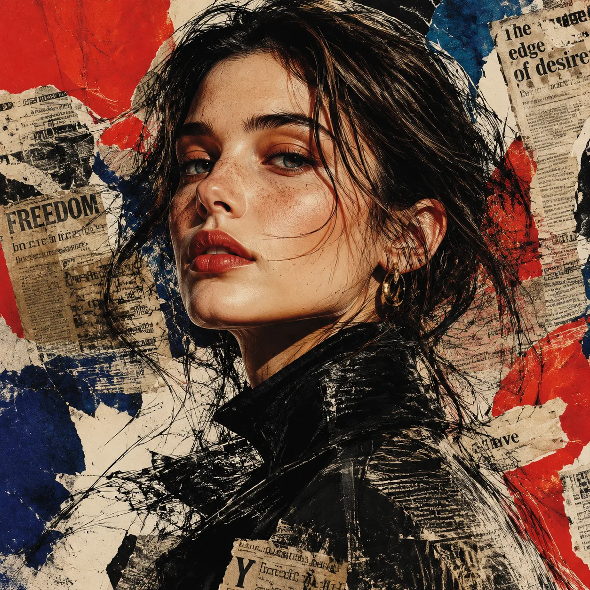

# Mixed-media portrait of SUBJECT , EXPRESSION , GAZE DIRECTION

[← Back to the collection](../../README.md) · Category: [Poster Design](../../gallery/poster-design.md) · Model: `Vinano Studio` · ID: `vn-00996`

<a href="https://vinano.ai?utm_source=github&utm_medium=readme&utm_campaign=awesome-image-video-prompts-updating&utm_content=prompt-page-image"></a>

<sub>Preview generated with <a href="https://vinano.ai?utm_source=github&utm_medium=readme&utm_campaign=awesome-image-video-prompts-updating&utm_content=prompt-page-caption">vinano.ai</a></sub>

## Prompt

```text
Mixed-media portrait of [SUBJECT], [EXPRESSION], [GAZE DIRECTION], [ACCESSORY/STYLING], realistic identity, black sketch strokes, torn newspaper collage, acrylic paint splashes, editorial print texture, blending realism and abstract expressionism, premium poster aesthetic, tactile handmade feel, high contrast, ultra-detailed face and eyes, [PRIMARY COLORS] and [SECONDARY COLORS] Preserve realistic proportions and depth for a confident, professional finish.
```

## Try it on vinano.ai

1. Copy the prompt above.
2. Open **[vinano.ai](https://vinano.ai?utm_source=github&utm_medium=readme&utm_campaign=awesome-image-video-prompts-updating&utm_content=prompt-page-try)**, paste it into the image generator and pick a model.
3. Swap any placeholders (brand, product, city, person…) for your own details, then generate.

More prompts like this: [Poster Design gallery](../../gallery/poster-design.md) · [all categories](../../README.md#contents)
