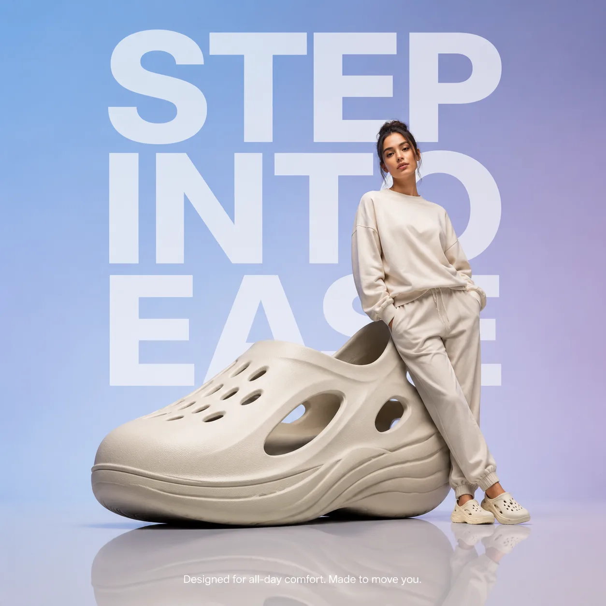

# Premium product advertisement featuring an oversized futuristic comfort clog

[← Back to the collection](../../README.md) · Category: [Poster Design](../../gallery/poster-design.md) · Model: `Vinano Studio` · ID: `vn-01157`

<a href="https://vinano.ai?utm_source=github&utm_medium=readme&utm_campaign=awesome-image-video-prompts-updating&utm_content=prompt-page-image"></a>

<sub>Preview generated with <a href="https://vinano.ai?utm_source=github&utm_medium=readme&utm_campaign=awesome-image-video-prompts-updating&utm_content=prompt-page-caption">vinano.ai</a></sub>

## Prompt

```text
A hyper-realistic premium product advertisement featuring an oversized futuristic comfort clog placed on a smooth glossy reflective floor. A modern model dressed in soft neutral-toned athleisure (off-white / beige) stands slightly leaning against the giant shoe a relaxed, confident posture.

Background: clean gradient blending soft sky blue into subtle lavender tones, massive bold typography in the background reading “STEP INTO EASE” in a modern sans-serif font, stretched vertically and partially behind the subject.

Lighting: high-end studio lighting soft highlights, gentle reflections on the floor, and subtle rim light outlining the model and product for depth.

Composition: editorial magazine layout, perfectly centered subject, strong negative space, luxury branding feel.

Additional text (small, minimal placement at bottom): “Designed for all-day comfort. Made to move you.”

Style: ultra-clean, Apple-style minimalism meets fashion campaign, hyper-realistic, premium commercial photography, 8K, sharp details.

Preserve realistic proportions and depth for a confident, professional finish.
```

## Try it on vinano.ai

1. Copy the prompt above.
2. Open **[vinano.ai](https://vinano.ai?utm_source=github&utm_medium=readme&utm_campaign=awesome-image-video-prompts-updating&utm_content=prompt-page-try)**, paste it into the image generator and pick a model.
3. Swap any placeholders (brand, product, city, person…) for your own details, then generate.

More prompts like this: [Poster Design gallery](../../gallery/poster-design.md) · [all categories](../../README.md#contents)
