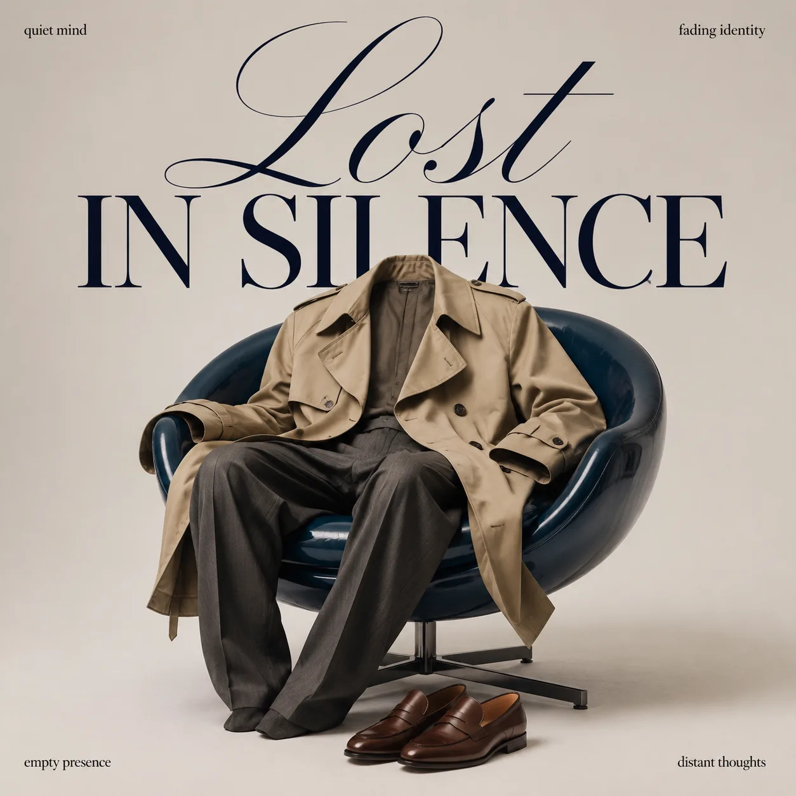

# Refined minimalist conceptual fashion editorial poster, studio shot

[← Back to the collection](../../README.md) · Category: [Poster Design](../../gallery/poster-design.md) · Model: `Vinano Studio` · ID: `vn-01158`

<a href="https://vinano.ai?utm_source=github&utm_medium=readme&utm_campaign=awesome-image-video-prompts-updating&utm_content=prompt-page-image"></a>

<sub>Preview generated with <a href="https://vinano.ai?utm_source=github&utm_medium=readme&utm_campaign=awesome-image-video-prompts-updating&utm_content=prompt-page-caption">vinano.ai</a></sub>

## Prompt

```text
refined minimalist conceptual fashion editorial poster, studio shot on a clean off-white seamless background. A glossy deep blue modern lounge chair placed in the center, an oversized beige trench coat and tailored charcoal trousers draped naturally over it, creating the illusion of an invisible person sitting there. Polished brown leather loafers placed neatly on the floor in front of the chair. Large elegant typography behind the chair reading “LOST IN SILENCE” — “Lost” in flowing luxury cursive script, “IN SILENCE” in bold serif uppercase. Small subtle text in the corners like “quiet mind,” “fading identity,” “empty presence,” and “distant thoughts.” High-fashion magazine cover aesthetic, cinematic soft, diffused lighting, muted tones, surreal emotional atmosphere, crisp composition, luxury editorial styling, premium fashion campaign look, artistic and symbolic. Render with rich micro-detail while keeping the layout uncluttered and intentional.
```

## Try it on vinano.ai

1. Copy the prompt above.
2. Open **[vinano.ai](https://vinano.ai?utm_source=github&utm_medium=readme&utm_campaign=awesome-image-video-prompts-updating&utm_content=prompt-page-try)**, paste it into the image generator and pick a model.
3. Swap any placeholders (brand, product, city, person…) for your own details, then generate.

More prompts like this: [Poster Design gallery](../../gallery/poster-design.md) · [all categories](../../README.md#contents)
