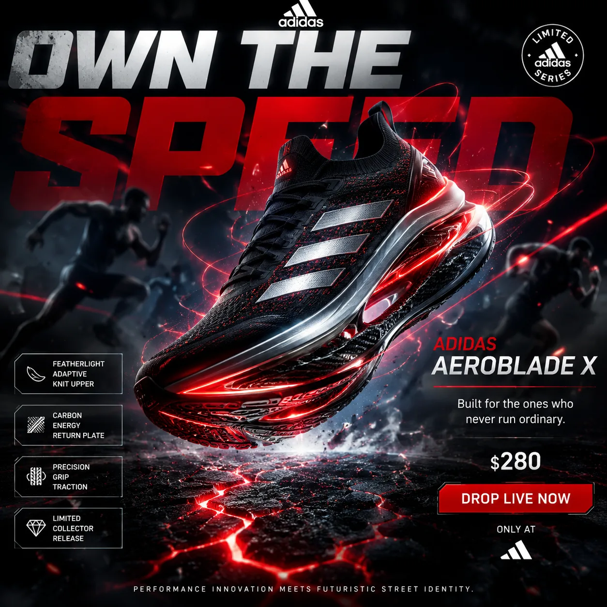

# Jaw-dropping premium advertising poster in 9:16 vertical format

[← Back to the collection](../../README.md) · Category: [Poster Design](../../gallery/poster-design.md) · Model: `Vinano Studio` · ID: `vn-01165`

<a href="https://vinano.ai?utm_source=github&utm_medium=readme&utm_campaign=awesome-image-video-prompts-updating&utm_content=prompt-page-image"></a>

<sub>Preview generated with <a href="https://vinano.ai?utm_source=github&utm_medium=readme&utm_campaign=awesome-image-video-prompts-updating&utm_content=prompt-page-caption">vinano.ai</a></sub>

## Prompt

```text
Create a jaw-dropping premium advertising poster in 9:16 vertical format for a fictional ultra-limited Adidas sneaker called "ADIDAS AEROBLADE X - LIMITED DROP". The design must feel like a world-class campaign by a top creative agency, highly original, futuristic, visually explosive, and impossible to ignore.

Main visual:
A single hero sneaker floating in the center, shot from a dramatic low angle, as if it is levitating above a black obsidian running track split by glowing energy cracks. The shoe should look ultra-premium, highly engineered, sleek, aerodynamic, and fashion-forward. Its material should combine knit mesh, sculpted foam, translucent panels, reflective stripes, and a carbon-fiber sole plate. Neon light trails swirl around the shoe like captured speed. Small particles and mist add motion and intensity. In the background, use faint silhouettes of elite runners frozen mid-sprint, blurred just enough to keep all attention on the shoe.

Color palette:
Matte black, electric red, silver, deep charcoal, subtle neon blue highlights.

Typography and poster copy:
Render all text cleanly, sharply, and professionally strong hierarchy.
Main headline:
"OWN THE SPEED"
Product title:
"ADIDAS AEROBLADE X"
Subheadline:
"Built for the ones who never run ordinary."
Feature callouts in elegant boxed layout:
- "Featherlight Adaptive Knit Upper"
- "Carbon Energy Return Plate"
- "Precision Grip Traction"
- "Limited Collector Release"
Price line:
"$280"
CTA:
"DROP LIVE NOW"
Secondary CTA:
"Only at
Small footer text:
"Performance innovation meets futuristic street identity."

Layout direction:
The headline should be bold and oversized, partially integrated into the background. Product name should sit near the shoe in a refined premium layout. Feature callouts should be clean, readable, and arranged vertically along one side. Add a subtle badge reading "LIMITED SERIES". The overall composition should feel like a luxury sports campaign mixed futuristic editorial design.

Style:
Ultra-detailed, hyper-realistic product photography, cinematic studio lighting, premium advertising aesthetics, sharp focus, rich textures, subtle atmosphere, dynamic motion energy, high-end commercial poster, no clutter, no generic template look.

Make the aspect ratio 9:16

Maintain consistent colour harmony and crisp focus across the whole frame.
```

## Try it on vinano.ai

1. Copy the prompt above.
2. Open **[vinano.ai](https://vinano.ai?utm_source=github&utm_medium=readme&utm_campaign=awesome-image-video-prompts-updating&utm_content=prompt-page-try)**, paste it into the image generator and pick a model.
3. Swap any placeholders (brand, product, city, person…) for your own details, then generate.

More prompts like this: [Poster Design gallery](../../gallery/poster-design.md) · [all categories](../../README.md#contents)
