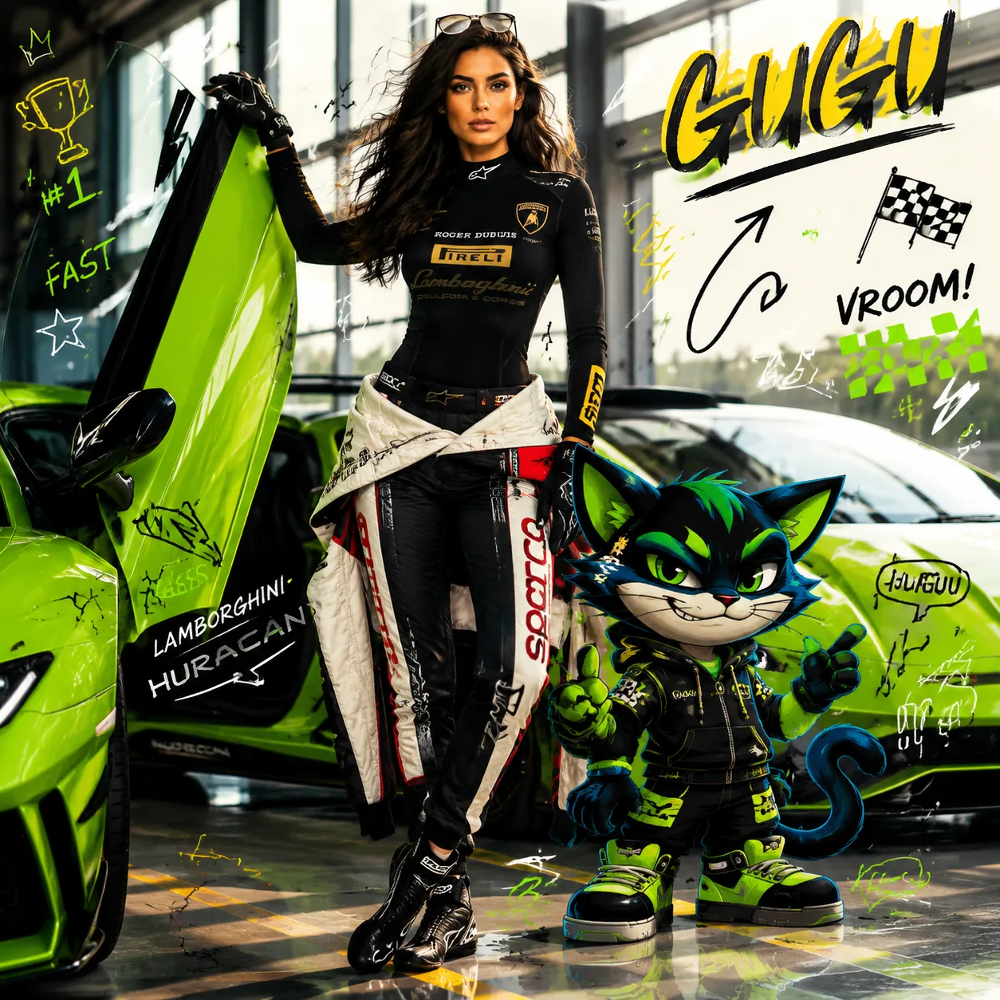

# Full-body fashion editorial shot of a confident young woman

[← Back to the collection](../../README.md) · Category: [Poster Design](../../gallery/poster-design.md) · Model: `Vinano Studio` · ID: `vn-01170`

<a href="https://vinano.ai?utm_source=github&utm_medium=readme&utm_campaign=awesome-image-video-prompts-updating&utm_content=prompt-page-image"></a>

<sub>Preview generated with <a href="https://vinano.ai?utm_source=github&utm_medium=readme&utm_campaign=awesome-image-video-prompts-updating&utm_content=prompt-page-caption">vinano.ai</a></sub>

## Prompt

```text
Full-body fashion editorial shot of a confident young woman long wavy dark brown hair, striking sharp facial features, defined cheekbones, deep-set eyes a calm dominant gaze, sunglasses perched on top of her head, standing in a powerful pose — one hand resting on an open scissor door, body slightly turned, looking straight at camera a composed, fierce expression.
Wearing a fitted black long-sleeve racing jersey gold sponsor logos (Alpinestars collar detail), black racing gloves, a white, black, and red Sparco racing suit draped and hanging off her body, and black racing shoes. Clean editorial styling, natural confident stance, wind slightly moving her dark wavy hair.
Beside and partially interacting a stylized cartoon Cat, positioned naturally as if sharing the same space. The Cat is illustrated in bold cartoon style thick black outlines, vibrant neon color palette (neon green, blue, yellow accents), exaggerated proportions, expressive features, playful yet powerful presence.
Background: bright indoor motorsport garage pit lane setting large industrial windows flooding soft diffused daylight, glossy reflective concrete floor, a neon green Lamborghini Huracán open scissor door partially visible.
Fusion of hyper-realistic photography and graphic illustration, seamless integration between subject and cartoon. Add graphic overlay elements: doodle Gugu arrows, scribbles, racing-themed abstract shapes, speed lines, comic-style symbols, dynamic motion lines, checkered flag doodles.
High contrast, HDR lighting, sharp focus, fashion editorial motorsport composition, surreal mixed-media aesthetic, ultra-detailed, 8K resolution.

Keep edges clean and the overall composition balanced for a polished, gallery-ready result.
```

## Try it on vinano.ai

1. Copy the prompt above.
2. Open **[vinano.ai](https://vinano.ai?utm_source=github&utm_medium=readme&utm_campaign=awesome-image-video-prompts-updating&utm_content=prompt-page-try)**, paste it into the image generator and pick a model.
3. Swap any placeholders (brand, product, city, person…) for your own details, then generate.

More prompts like this: [Poster Design gallery](../../gallery/poster-design.md) · [all categories](../../README.md#contents)
