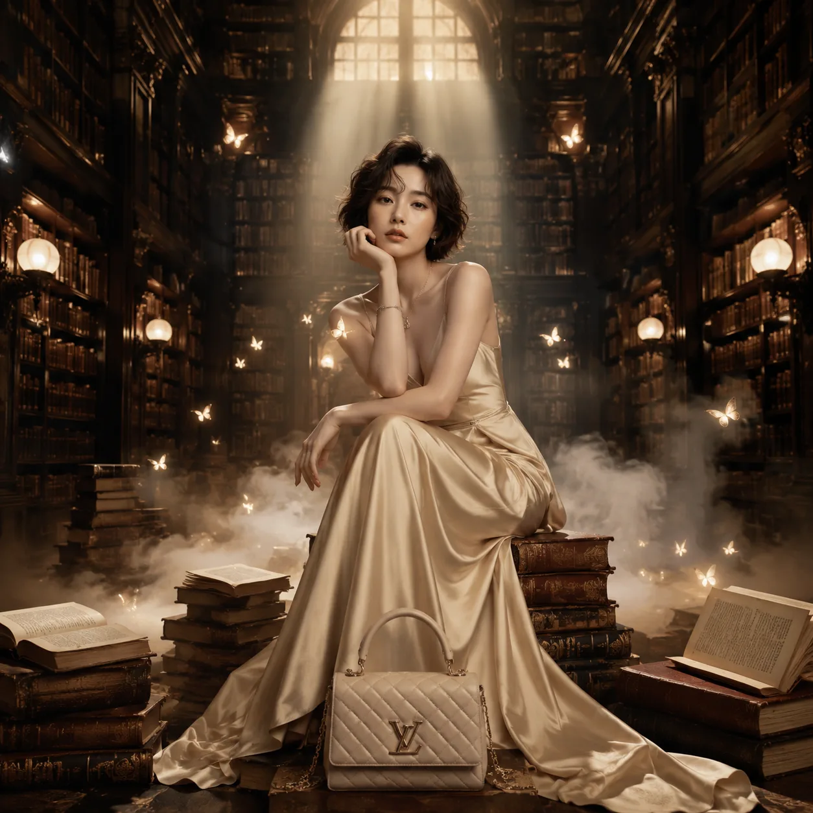

# Luxury fashion editorial set inside a grand vintage library

[← Back to the collection](../../README.md) · Category: [Poster Design](../../gallery/poster-design.md) · Model: `Vinano Studio` · ID: `vn-01178`

<a href="https://vinano.ai?utm_source=github&utm_medium=readme&utm_campaign=awesome-image-video-prompts-updating&utm_content=prompt-page-image"></a>

<sub>Preview generated with <a href="https://vinano.ai?utm_source=github&utm_medium=readme&utm_campaign=awesome-image-video-prompts-updating&utm_content=prompt-page-caption">vinano.ai</a></sub>

## Prompt

```text
A cinematic luxury fashion editorial set inside a grand vintage library tall wooden bookshelves, soft fog covering the floor, and glowing butterflies floating in the air. A beautiful young woman short wavy bob hair and soft natural makeup sits centered on a stack of antique books. She wears an elegant flowing satin gown in champagne color, posed gracefully one hand resting on her face. A luxury designer handbag is placed prominently in front. Dramatic spotlight from above, symmetrical composition, moody atmosphere, shallow depth of field, ultra-realistic, high detail, 8K, fashion magazine style, premium aesthetic, soft shadows, rich tones. Maintain consistent colour harmony and crisp focus across the whole frame.
```

## Try it on vinano.ai

1. Copy the prompt above.
2. Open **[vinano.ai](https://vinano.ai?utm_source=github&utm_medium=readme&utm_campaign=awesome-image-video-prompts-updating&utm_content=prompt-page-try)**, paste it into the image generator and pick a model.
3. Swap any placeholders (brand, product, city, person…) for your own details, then generate.

More prompts like this: [Poster Design gallery](../../gallery/poster-design.md) · [all categories](../../README.md#contents)
