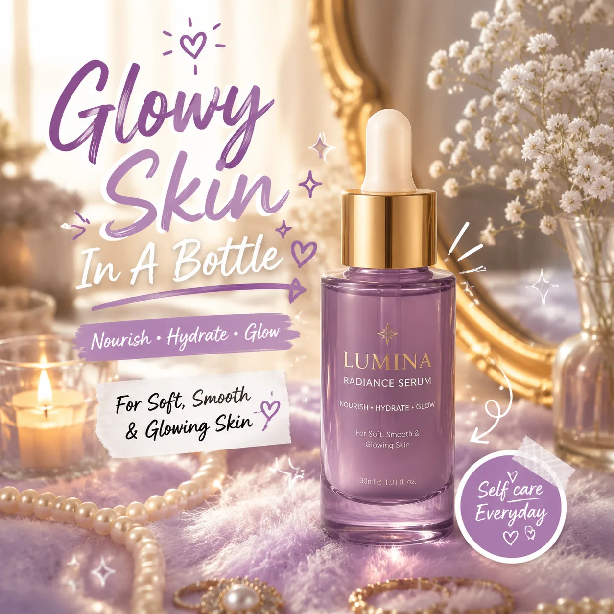

# Luxury aesthetic skincare advertisement,soft pastel background, warm golden sunlight

[← Back to the collection](../../README.md) · Category: [Poster Design](../../gallery/poster-design.md) · Model: `Vinano Studio` · ID: `vn-01182`

<a href="https://vinano.ai?utm_source=github&utm_medium=readme&utm_campaign=awesome-image-video-prompts-updating&utm_content=prompt-page-image"></a>

<sub>Preview generated with <a href="https://vinano.ai?utm_source=github&utm_medium=readme&utm_campaign=awesome-image-video-prompts-updating&utm_content=prompt-page-caption">vinano.ai</a></sub>

## Prompt

```text
Luxury aesthetic skincare advertisement,soft pastel background, warm golden sunlight, dreamy soft focus, feminine vanity setup mirror, pearls, candle and baby breath flowers.Cozy purple fluffy surface, high-end beauty branding style, ultra realistic, 4k, studio lighting, glossy reflection, soft shadows, bokeh background.
Add cute doodle elements (white and purple hand-drawn arrows, sparkles, hearts), handwritten notes and stickers.

Text overlay: "Glowy Skin In A Bottle" (big hand writing font)"Nourish • Hydrate • Glow"
"For Soft, Smooth & Glowing Skin","Self care Everyday"
crisp composition, aesthetic, viral beauty ad style, Instagram / TikTok/ X friendly (but no UI), premium soft feminine branding

Render with rich micro-detail while keeping the layout uncluttered and intentional.
```

## Try it on vinano.ai

1. Copy the prompt above.
2. Open **[vinano.ai](https://vinano.ai?utm_source=github&utm_medium=readme&utm_campaign=awesome-image-video-prompts-updating&utm_content=prompt-page-try)**, paste it into the image generator and pick a model.
3. Swap any placeholders (brand, product, city, person…) for your own details, then generate.

More prompts like this: [Poster Design gallery](../../gallery/poster-design.md) · [all categories](../../README.md#contents)
