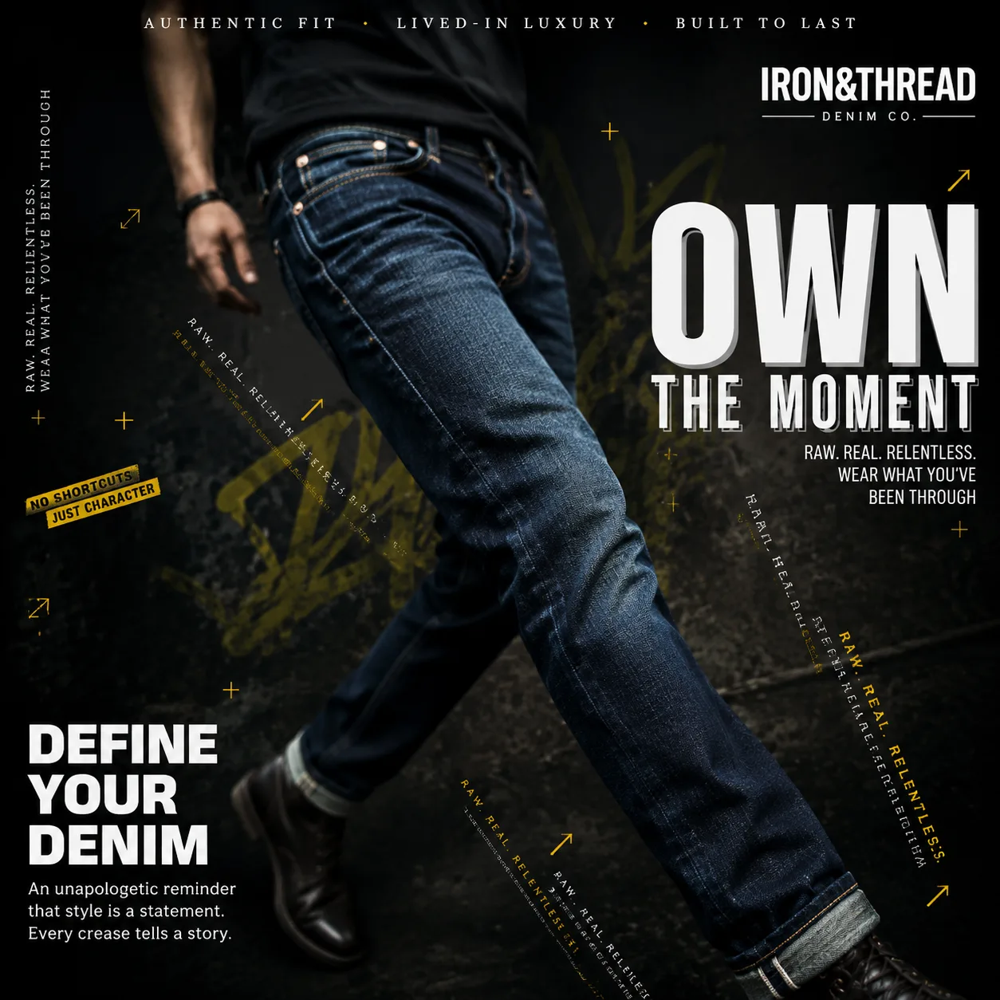

# Hyperrealistic premium denim advertisement shot in a dark, moody

[← Back to the collection](../../README.md) · Category: [Poster Design](../../gallery/poster-design.md) · Model: `Vinano Studio` · ID: `vn-01185`

<a href="https://vinano.ai?utm_source=github&utm_medium=readme&utm_campaign=awesome-image-video-prompts-updating&utm_content=prompt-page-image"></a>

<sub>Preview generated with <a href="https://vinano.ai?utm_source=github&utm_medium=readme&utm_campaign=awesome-image-video-prompts-updating&utm_content=prompt-page-caption">vinano.ai</a></sub>

## Prompt

```text
A hyperrealistic premium denim advertisement shot in a dark, moody editorial style. A male figure wearing raw selvedge denim jeans is captured mid-stride against a near-black charcoal background, body angled diagonally at a bold 45-degree perspective toward the camera. The jeans feature a slim tapered silhouette deep indigo wash, subtle thigh and knee fading, reinforced copper rivets catching ambient light, and clean off-white contrast stitching, dominating the lower two-thirds of the frame. The composition uses shallow depth of field sharp focus on the denim texture and soft blur on the upper torso. The background is layered subtle urban texture — faint graffiti strokes in electric yellow and muted olive, barely visible through a heavy dark vignette. Multiple rows of ultra-small all-caps typographic text orbit the figure at different angles reading phrases like "RAW. REAL. RELENTLESS." and "WEAR WHAT YOU'VE BEEN THROUGH" — some running vertically, some at 30-degree angles, creating a chaotic yet intentional graphic zine energy. At the upper right, a bold brand wordmark appears in clean white against the dark background. At the top center, a thin horizontal navigation-style text bar reads "AUTHENTIC FIT · LIVED-IN LUXURY · BUILT TO LAST" in spaced all-caps serif font. A large commanding headline is placed center-right — "OWN" in massive ultra-bold white letters followed by "THE MOMENT" in lighter weight creating dramatic type hierarchy. Small yellow plus (+) symbols and diagonal arrows (↗) are scattered throughout as accent details. Bottom left features a bold slogan lockup: "DEFINE YOUR DENIM" in large bold sans-serif white text a thin subline reading "An unapologetic reminder that style is a statement. Every crease tells a story." The overall lighting is dramatic and directional — a single cold key light from the left causing copper rivets to shimmer and deep indigo denim to glow subtle sheen against the darkness. Close macro detail visible on the fabric weave texture near the knee fade. true-to-life photorealistic. Commercial photography quality. High contrast. 4K resolution. 3:4 vertical format optimized for social media. Maintain consistent colour harmony and crisp focus across the whole frame.
```

## Try it on vinano.ai

1. Copy the prompt above.
2. Open **[vinano.ai](https://vinano.ai?utm_source=github&utm_medium=readme&utm_campaign=awesome-image-video-prompts-updating&utm_content=prompt-page-try)**, paste it into the image generator and pick a model.
3. Swap any placeholders (brand, product, city, person…) for your own details, then generate.

More prompts like this: [Poster Design gallery](../../gallery/poster-design.md) · [all categories](../../README.md#contents)
