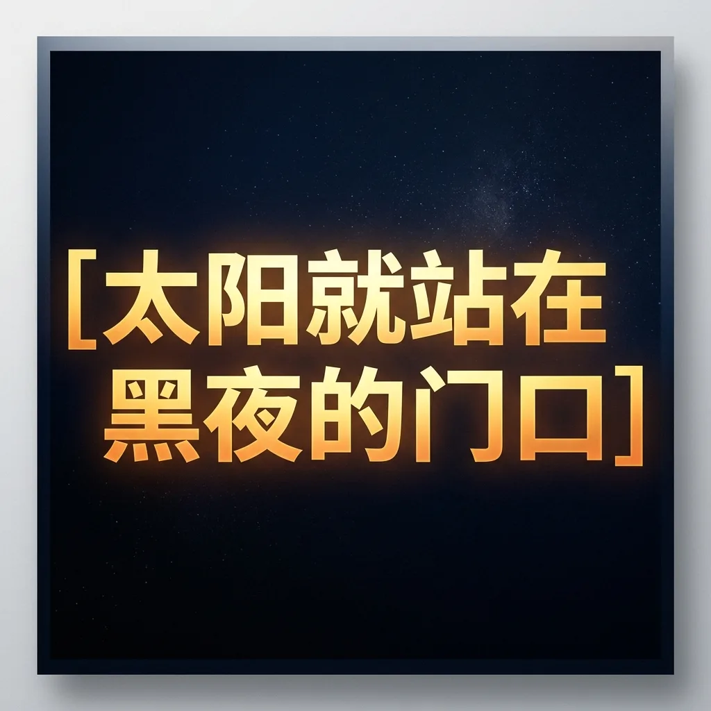

# 本次是生成图片任务

[← Back to the collection](../../README.md) · Category: [Poster Design](../../gallery/poster-design.md) · Model: `Vinano Image Pro` · ID: `vn-01192`

<a href="https://vinano.ai?utm_source=github&utm_medium=readme&utm_campaign=awesome-image-video-prompts-updating&utm_content=prompt-page-image"></a>

<sub>Preview generated with <a href="https://vinano.ai?utm_source=github&utm_medium=readme&utm_campaign=awesome-image-video-prompts-updating&utm_content=prompt-page-caption">vinano.ai</a></sub>

## Prompt

````text
本次是生成图片任务：
苹果设计师思维，顶级海报大师思维，用高桥流思路
呈现海报设计
表现如下文本，让其抓人，直击人心
你可以智能理解文本，不一定照单全收文本，智能梳理文本， 把握人性，突出看点。尤其是我输入大段文本， 你核心呈现的，应该是你理解和处理后的核心文本
智能判定适合文本语义的配色逻辑，合理排版，有呼吸感的呈现文案
不要额外添加文字， 超大字展示这个文案
```
[太阳就站在黑夜的门口]
```

整体保持边缘干净、构图均衡，呈现可直接使用的精致成品感。
````

## Try it on vinano.ai

1. Copy the prompt above.
2. Open **[vinano.ai](https://vinano.ai?utm_source=github&utm_medium=readme&utm_campaign=awesome-image-video-prompts-updating&utm_content=prompt-page-try)**, paste it into the image generator and pick a model.
3. Swap any placeholders (brand, product, city, person…) for your own details, then generate.

More prompts like this: [Poster Design gallery](../../gallery/poster-design.md) · [all categories](../../README.md#contents)
