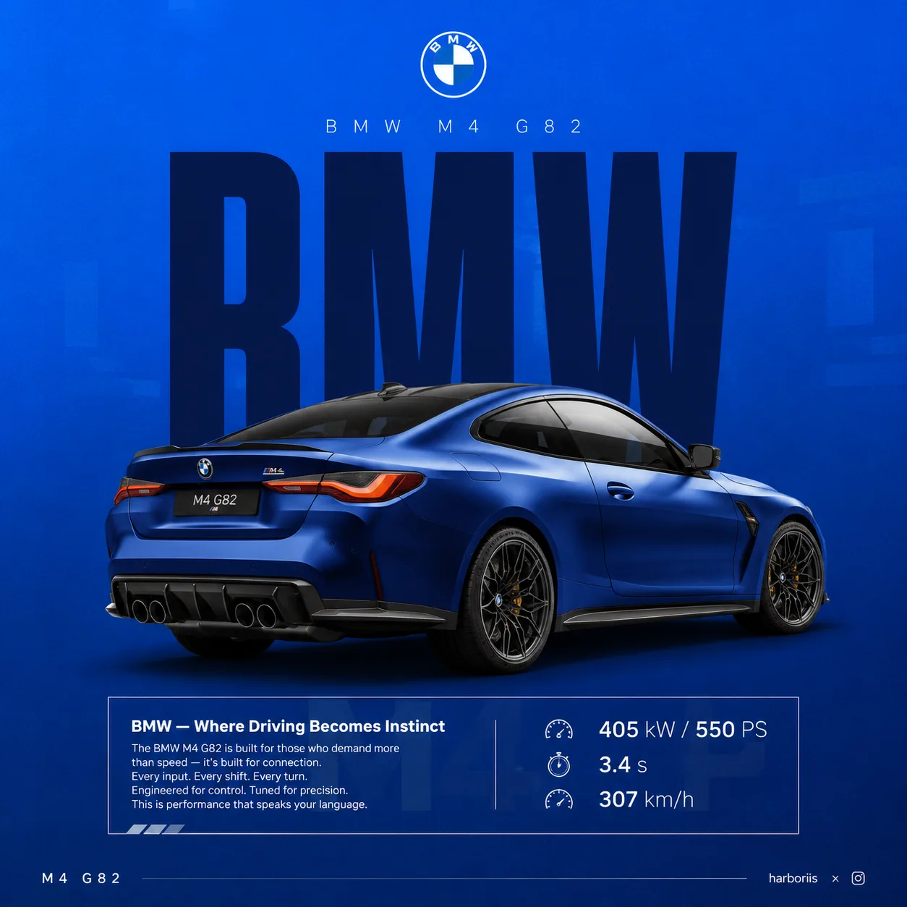

# 4:5 vertical social poster in ultra high resolution, 8K

[← Back to the collection](../../README.md) · Category: [Poster Design](../../gallery/poster-design.md) · Model: `Vinano Studio` · ID: `vn-01198`

<a href="https://vinano.ai?utm_source=github&utm_medium=readme&utm_campaign=awesome-image-video-prompts-updating&utm_content=prompt-page-image"></a>

<sub>Preview generated with <a href="https://vinano.ai?utm_source=github&utm_medium=readme&utm_campaign=awesome-image-video-prompts-updating&utm_content=prompt-page-caption">vinano.ai</a></sub>

## Prompt

```text
Create a 4:5 vertical social poster in ultra high resolution, 8K print quality sharpness. Use the BMW car from the reference image as the main subject and use the background structure/composition from the reference image, but transform it into a BMW themed design. Replace all black tones a flat high-saturation BMW blue background. Keep the same layout, spacing, visual balance, and poster composition from the reference image.

Background should use a smooth gradient from slightly lighter electric blue at the top to deep navy blue at the bottom. Add subtle grain texture (2 to 3%) and faint rectangular overlays (2 to 4% opacity). Keep it clean, graphic, premium, and non-realistic. Add a soft contact shadow under the car.

Use the same BMW from the reference image, changing only the paint color to matte frozen blue or deep metallic navy. Keep the original body shape, wheels, stance, and design details from the reference image.

Show the car in a rear 3/4 perspective matching the reference image angle exactly. Use a slightly elevated camera angle. Position the car slightly right of center.

Include visible carbon roof, aggressive rear diffuser, sharp controlled reflections, and subtle brake details.

Keep composition identical to the reference image:
Top: branding
Middle: giant type
Center: car overlapping text
Bottom: editorial block and specs

Typography:

Primary text: “BMW”
Ultra condensed bold sans serif, tall vertical scaling like the reference poster. Color deep navy or near black. Static text no distortion. Acts as structural backdrop.

Secondary header: “BMW M4 G82”
Thin font wide tracking.

Logo area: BMW roundel centered above.

Editorial block:

Headline: “BMW — Where Driving Becomes Instinct”

Body copy focused on:

driver connection

control

performance precision

Use the same boxed editorial layout as the reference image.

Background faded text: “M4” large scale 3 to 5% opacity behind the box.

Bottom left:
“ M4 G82”

Bottom right specs:

405 kW / 550 PS
3.4 s
307 km/h

Lighting should be clean studio lighting sharp but controlled highlights.

Color grading should use deep blues, high contrast, clean blacks.

Camera lens: 50mm, slightly elevated rear 3/4 angle.

Mood:
Performance.
Precision.
Driver focus.

Add Bottom-right watermark: harboriis, small x and Instagram logo

Aim for an editorial, design-driven look with deliberate negative space.
```

## Try it on vinano.ai

1. Copy the prompt above.
2. Open **[vinano.ai](https://vinano.ai?utm_source=github&utm_medium=readme&utm_campaign=awesome-image-video-prompts-updating&utm_content=prompt-page-try)**, paste it into the image generator and pick a model.
3. Swap any placeholders (brand, product, city, person…) for your own details, then generate.

More prompts like this: [Poster Design gallery](../../gallery/poster-design.md) · [all categories](../../README.md#contents)
