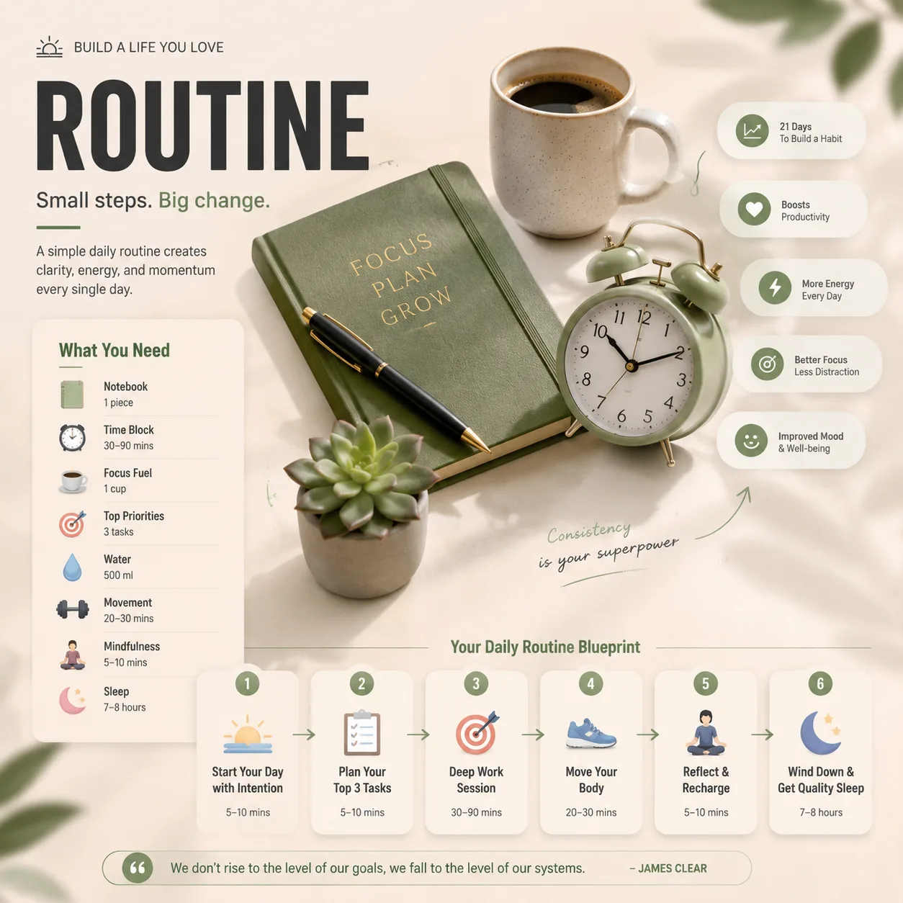

# Ultra-clean modern editorial infographic

[← Back to the collection](../../README.md) · Category: [Poster Design](../../gallery/poster-design.md) · Model: `Vinano Studio` · ID: `vn-01199`

<a href="https://vinano.ai?utm_source=github&utm_medium=readme&utm_campaign=awesome-image-video-prompts-updating&utm_content=prompt-page-image"></a>

<sub>Preview generated with <a href="https://vinano.ai?utm_source=github&utm_medium=readme&utm_campaign=awesome-image-video-prompts-updating&utm_content=prompt-page-caption">vinano.ai</a></sub>

## Prompt

```text
Ultra-clean modern editorial infographic. The topic is [ROUTINE] routine. Base all visuals, colors, objects, mood, ingredients, and steps entirely on this topic. Hero visual: a stylized flat-lay or floating arrangement of 3–4 iconic objects associated this topic — slightly angled or in soft perspective, glowing subtly. All elements arranged dynamically around the hero in a non-restrictive editorial layout. Ingredients Section: Label it ‘What You Need’ — include 6–8 relevant items small icons or emoji illustrations next to each, a practical quantity or duration written like a recipe. Steps Section: 5–6 numbered panels arrows or connecting lines forming a logical flow, each a short action label and small relevant icon, glassmorphism or frosted card styling. Stats Badges: 4–5 floating pill-shaped badges showing relevant metadata, displayed as clean minimal bubbles near the hero. Visual Style: Choose background color, accent colors, typography weight, and texture to naturally match the topic’s mood. Bold modern sans-serif typography. Clean vector icons. Subtle grain or texture. Composition: Hero centered or slightly offset, ingredients one side, steps opposite or below connecting lines, stat badges as floating pills, generous negative space. Lighting: Soft natural studio lighting matching the topic’s tone. Premium editorial aesthetic, social-feed optimized. Ultra-crisp. No watermark Emphasise material texture and natural light so the final frame feels tactile and premium.
```

## Try it on vinano.ai

1. Copy the prompt above.
2. Open **[vinano.ai](https://vinano.ai?utm_source=github&utm_medium=readme&utm_campaign=awesome-image-video-prompts-updating&utm_content=prompt-page-try)**, paste it into the image generator and pick a model.
3. Swap any placeholders (brand, product, city, person…) for your own details, then generate.

More prompts like this: [Poster Design gallery](../../gallery/poster-design.md) · [all categories](../../README.md#contents)
