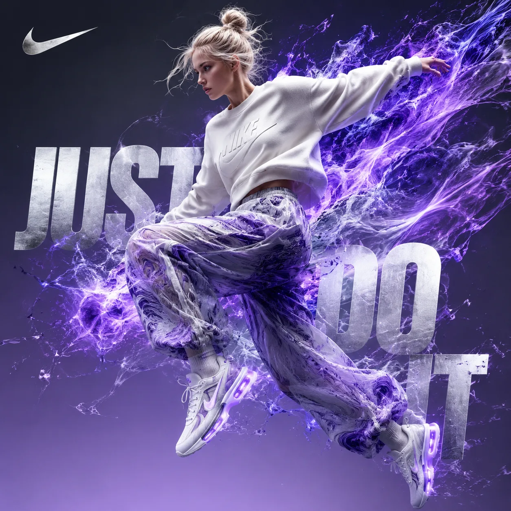

# Highly detailed digital artwork in a surreal, dynamic style

[← Back to the collection](../../README.md) · Category: [Poster Design](../../gallery/poster-design.md) · Model: `Vinano Studio` · ID: `vn-01204`

<a href="https://vinano.ai?utm_source=github&utm_medium=readme&utm_campaign=awesome-image-video-prompts-updating&utm_content=prompt-page-image"></a>

<sub>Preview generated with <a href="https://vinano.ai?utm_source=github&utm_medium=readme&utm_campaign=awesome-image-video-prompts-updating&utm_content=prompt-page-caption">vinano.ai</a></sub>

## Prompt

```text
A highly detailed digital artwork in a surreal, dynamic style inspired by premium athletic advertising for Nike, Inc. A young athletic woman platinum blonde hair tied in a messy bun, fair skin, and a fiercely focused expression is captured mid-jump or leap, her body leaning slightly forward as if bursting raw, untamed energy.
She wears a loose, off-white Nike crewneck sweatshirt subtle embossed Nike branding on the chest, paired flowy, semi-transparent pants featuring a swirling marbled pattern in graphite grey and electric violet, billowing dramatically around her legs. On her feet are sleek, futuristic white Nike sneakers glowing violet accents, visible Air-inspired sole details, and an aerodynamic design.
Vibrant electric violet energy or ethereal smoke erupts dramatically from behind her, swirling and dissolving into abstract, cloud-like forms that interact her clothing, creating a powerful sense of motion and release.
The background is a deep, moody gradient transitioning from charcoal grey to luminous twilight violet, emphasizing a refined minimalist yet striking composition.
Overlay large, bold metallic silver text reading “Just Do It” in a sharp, modern sans-serif font, partially integrated and obscured by the energy smoke and the figure, making it feel like an organic part of the scene.
Include the iconic Nike Swoosh logo in the top-left corner in shimmering silver.

Preserve realistic proportions and depth for a confident, professional finish.
```

## Try it on vinano.ai

1. Copy the prompt above.
2. Open **[vinano.ai](https://vinano.ai?utm_source=github&utm_medium=readme&utm_campaign=awesome-image-video-prompts-updating&utm_content=prompt-page-try)**, paste it into the image generator and pick a model.
3. Swap any placeholders (brand, product, city, person…) for your own details, then generate.

More prompts like this: [Poster Design gallery](../../gallery/poster-design.md) · [all categories](../../README.md#contents)
