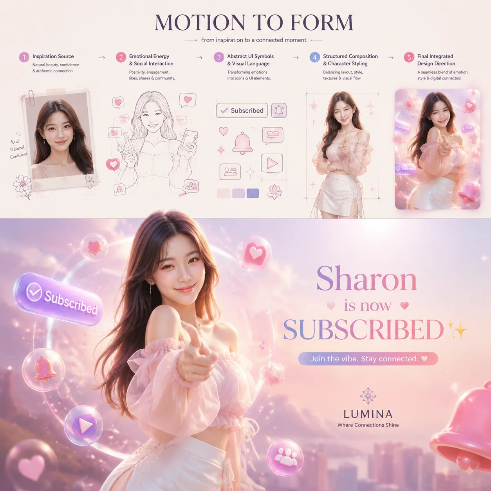

# Translate this theme from concept into form, and present

[← Back to the collection](../../README.md) · Category: [Poster Design](../../gallery/poster-design.md) · Model: `Vinano Studio` · ID: `vn-01211`

<a href="https://vinano.ai?utm_source=github&utm_medium=readme&utm_campaign=awesome-image-video-prompts-updating&utm_content=prompt-page-image"></a>

<sub>Preview generated with <a href="https://vinano.ai?utm_source=github&utm_medium=readme&utm_campaign=awesome-image-video-prompts-updating&utm_content=prompt-page-caption">vinano.ai</a></sub>

## Prompt

```text
Translate this theme from concept into form, and present both the transformation process and the final outcome within a single vertical A4 composition.
Use a two-tier layout (top and bottom sections).
Top Section:
A 5-step visual process diagram that captures the essence of the theme.
Structure the flow as:
Inspiration source → Emotional energy & social interaction → Abstract UI symbols and visual language → Structured composition & character styling → Final integrated design direction
Use the first reference image strictly for Sharon’s identity, facial features, and expression
Use the second reference image for outfit, pose, and styling direction
Visual style:
Delicate sketching, soft line art, UI-inspired diagram elements
Floating icons like “Subscribed”, hearts, notification bells, social symbols
Small arrows, micro annotations, short English labels
Clean spacing refined, minimal layout
Title: “MOTION TO FORM”
Bottom Section:
A hero visual derived from the process above.
A cute, premium advertising poster featuring Sharon in a glowing, dreamy environment
She appears radiant, confident, and joyful, embodying a “subscribed / viral moment”
Blend both reference images seamlessly (face from image 1, styling from image 2)
Design direction:
Soft pastel gradient background (pink, lavender, baby blue)
Subtle golden-hour glow light neon accents
Floating 3D UI elements (Subscribed badges, hearts, icons)
Cinematic depth, soft lens flare, light particles, bokeh
Typography:
Main text: “Sharon is now SUBSCRIBED ✨”
Secondary tagline: “Join the vibe. Stay connected.”
Add a fictional brand/platform name (AI-generated)
Overall Direction:
The final visual should feel like a fusion of:
Concept board
Social media campaign poster
Design development sheet
Style:
Minimal, poetic, intelligent
Clean negative space balanced composition
Neutral base tones 1–2 soft pastel accent colors
Focus on:
Skin glow and natural beauty enhancement
Fabric texture and styling details
Light, shadow, and material realism
UI elements integrated as part of the aesthetic
Rendering quality:
Ultra high resolution
Commercial advertising quality
Soft, dreamy, cinematic finish

Preserve realistic proportions and depth for a confident, professional finish.
```

## Try it on vinano.ai

1. Copy the prompt above.
2. Open **[vinano.ai](https://vinano.ai?utm_source=github&utm_medium=readme&utm_campaign=awesome-image-video-prompts-updating&utm_content=prompt-page-try)**, paste it into the image generator and pick a model.
3. Swap any placeholders (brand, product, city, person…) for your own details, then generate.

More prompts like this: [Poster Design gallery](../../gallery/poster-design.md) · [all categories](../../README.md#contents)
